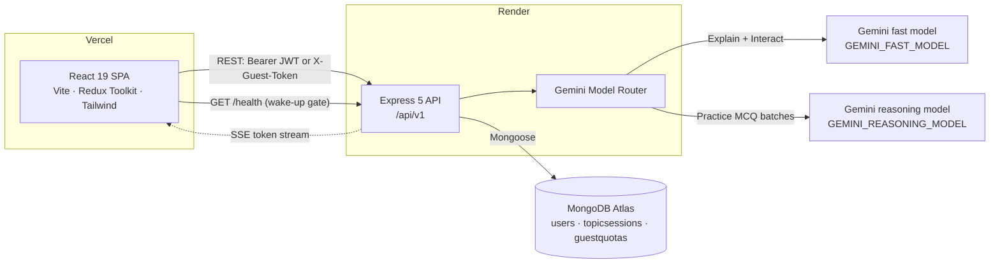

<div align="center">

# Mentora

**An AI tutor that teaches any topic in three structured modes: progressive explanation, guided Socratic dialogue, and tiered self-testing, all calibrated to the learner's level.**

[](https://mentoraclient.vercel.app/)

[](https://www.typescriptlang.org/)
[](https://react.dev/)
[](https://nodejs.org/)
[](https://expressjs.com/)
[](https://www.mongodb.com/atlas)
[](https://tailwindcss.com/)
[](https://ai.google.dev/)

</div>

<!-- Add screenshots of Explain, Interact, and Practice modes here -->

---

## Overview

General-purpose AI chat is a weak study tool: it answers with walls of text, its "Socratic" tutoring loops on questions the learner can't answer, and the quizzes it writes for you often carry wrong answer keys. Mentora puts every topic into one workspace with three modes (**Explain**, **Interact**, **Practice**), each backed by structured Gemini output and server-side state rather than free-form chat. Every response is calibrated to a learner profile (education level × explanation style). Visitors can start in **Guest Mode** with no signup, or register to keep a profile and session history.

---

## Key Features

- **Explain Mode.** A topic is broken into 4 progressive cards (*Intuition → Core Mechanism → Example → Check-for-Understanding*), revealed one at a time under a sticky step tracker. Content renders as GFM Markdown with tables, KaTeX math, syntax-highlighted code blocks with copy buttons, and Mermaid diagrams. Diagram source is sanitized on the server, and the client falls back to a plain code block if a diagram fails to render.
- **Interact Mode.** Goal-oriented Socratic tutoring across 3–5 conceptual milestones, with replies streamed token by token over **Server-Sent Events**. A deterministic **3-Strike Socratic Circuit Breaker** escalates from a *Nudge* to a *Concrete Hint* to a *Direct Explanation*, and an **"Explain directly"** button skips straight to the explanation at any point.
- **Practice Mode.** 10-question MCQ batches in three tiers (**Easy → Medium → Hard**), where submitting a tier unlocks the next. Hints are available per question, selected answers are saved to `localStorage` so a refresh mid-quiz loses nothing, and grading happens on the server against the stored key with no LLM call. A Batch Review then shows each answer next to the correct one with a step-by-step rationale.
- **Guest Mode and Accounts.**
  - *Guest Mode* is one click: each guest session lives for 2 hours (MongoDB TTL index), is unlocked by its own signed `X-Guest-Token`, and draws on a daily quota of 15 AI actions per client IP.
  - *Accounts* use JWT auth, a 2-step **Static Learner Profile** (`Education Level` × `Explanation Style`), and a history sidebar for resuming saved sessions.
- **Production hardening.**
  - *Scope guardrails:* every AI call returns an `isEducationalValid` flag, and off-topic requests get a polite refusal.
  - *Usage limits:* each user gets 50 AI actions per 24-hour window (configurable). Quota is reserved atomically before an AI call and released if the call fails.
  - *Cold-start gate:* the client checks `/health` before it renders. A warm server answers within a 350 ms grace window, so the wake-up screen never flashes.

---

## Engineering Highlights

- **Reasoning-First MCQ schema.** The Gemini `responseSchema` sets `propertyOrdering` so that `solutionExplanation` is generated *before* `correctOptionIndex`. The model works out the answer before it commits to an option, instead of picking a letter and justifying it afterwards.
- **Deterministic state machines around a probabilistic model.** Each Interact reply opens with an inline `<<MENTORA_STATE:{"outcome":...}>>` control header. The server parses it, strips it from the SSE stream, and passes it to a pure transition function that owns the strike count. The model can't skip the nudge or the hint: an early `CIRCUIT_BREAKER_ACK` is counted as an ordinary strike, and off-topic replies don't count as strikes. Practice grading is a fixed 10-element comparison against the stored key: O(1) per batch, with no model in the loop.
- **Answer-key masking.** Until a batch is `completed`, `sanitizePracticeBatch` removes `correctOptionIndex` and `solutionExplanation` from every API response, so the key never reaches the browser while the quiz is in progress.
- **Monorepo contract safety (`@mentora/shared`).** Zod schemas, enums, constants, and inferred DTO types live in one package and are imported by both the server (request validation, AI-output validation) and the client. Every workspace extends a strict `tsconfig.base.json` (`strict`, `noImplicitAny`, `noUncheckedIndexedAccess`).
- **Split-origin cloud resilience.** The client (Vercel) and API (Render) are on different sites. Auth uses stateless `Authorization: Bearer` JWTs instead of cookies, which avoids third-party-cookie blocking (Safari ITP). The SSE writer sends `X-Accel-Buffering: no` and `Cache-Control: no-transform`, plus a `: keepalive` comment every 15 s, so proxies neither buffer nor drop the stream. If the client disconnects, an `AbortSignal` cancels the upstream Gemini call.
- **Abuse-resistant guest identity.** Guest quotas and rate limits are keyed by a single client-IP resolver. It reads `cf-connecting-ip` on Render, falls back to the `TRUST_PROXY` hop count, and never reads the left-most `X-Forwarded-For` entries, which the client controls. Quota counters are kept in MongoDB, so they survive restarts.

---

## System Architecture



**Dual-model routing.** `model.router.ts` sends Explain and Interact operations to `GEMINI_FAST_MODEL` and Practice batch generation to `GEMINI_REASONING_MODEL`. Both default to `gemini-3.5-flash-lite`, and either can be pointed at a larger model through environment variables without code changes.

### Monorepo Structure

```text
mentora/
├── packages/
│   └── shared/          # @mentora/shared: Zod schemas, enums, constants, inferred DTO types
├── apps/
│   ├── server/          # @mentora/server: Express API
│   │   └── src/
│   │       ├── ai/            # Gemini client, model router, prompt builder, response schemas
│   │       ├── controllers/   # HTTP + SSE handlers
│   │       ├── middlewares/   # auth, session access, quota reservation, rate limits, validation
│   │       ├── models/        # Mongoose: User, TopicSession, GuestQuota
│   │       ├── repositories/  # data access
│   │       ├── services/      # Explain / Interact / Practice engines
│   │       └── scripts/       # offline AI eval suite
│   └── client/          # @mentora/client: React SPA
│       └── src/
│           ├── components/    # explain/, interact/, practice/, layout/, common/
│           ├── hooks/         # SSE stream, quiz drafts, server readiness, quota
│           ├── pages/ routes/ # pages + auth / onboarding guards
│           └── store/         # Redux slices: auth, session, ui
├── docs/                # architecture, requirements, implementation plan
└── render.yaml          # Render blueprint (backend)
```

---

## Tech Stack

| Layer | Technologies |
| :--- | :--- |
| **Frontend** | React 19, Vite 8, TypeScript, Redux Toolkit, React Router 7, Tailwind CSS 3, Axios |
| **Backend** | Node.js ≥ 20, Express 5, `jsonwebtoken`, `bcryptjs`, Helmet, CORS, `express-rate-limit`, Pino |
| **Database** | MongoDB Atlas, Mongoose 9 (TTL indexes for guest sessions and guest quotas) |
| **AI & Streaming** | Google Gemini via `@google/genai` (structured JSON schemas, dual-model routing), Server-Sent Events |
| **Rendering** | `react-markdown` + `remark-gfm`, KaTeX (`remark-math` / `rehype-katex`), `react-syntax-highlighter`, Mermaid |
| **Validation & Shared** | Zod 4, `@mentora/shared` workspace package, pnpm workspaces |
| **Testing** | Vitest, Supertest, `mongodb-memory-server`, React Testing Library, offline AI eval script |
| **Deployment** | Vercel (client), Render (API, `render.yaml`), MongoDB Atlas |

---

## How to Use

### Quick Try (Guest Mode)

1. Open the [live demo](https://mentoraclient.vercel.app/). If the Render instance is asleep, a short wake-up screen shows while it starts.
2. Type any topic (e.g. *"Deadlocks in operating systems"*) and pick a starting mode. No signup is needed.
3. Switch between **Explain**, **Interact**, and **Practice** with the tabs; all three work on the same topic session.

### Full Experience (Account Mode)

1. **Register**, then complete the 2-step **Static Learner Profile** (education level, then explanation style). You can change it later from Profile Settings.
2. Start topics as above. Every session is saved to the **history sidebar** with its Explain progress, Interact transcript, and Practice results, so you can pick up where you left off.

### Run Locally

**Prerequisites:** Node.js ≥ 20, pnpm, a MongoDB connection string, and a [Google AI Studio](https://aistudio.google.com/) API key.

```bash
pnpm install

cp apps/server/.env.example apps/server/.env   # fill in MONGODB_URI, JWT_SECRET (≥ 32 chars), GEMINI_API_KEY
cp apps/client/.env.example apps/client/.env   # VITE_API_BASE_URL=http://localhost:4000/api/v1

pnpm --filter @mentora/shared build            # build shared contracts first
pnpm --filter @mentora/server dev              # API on http://localhost:4000
pnpm --filter @mentora/client dev              # client on http://localhost:5173 (second terminal)
```

| Server variable | Purpose |
| :--- | :--- |
| `MONGODB_URI`, `JWT_SECRET`, `GEMINI_API_KEY` | Required. Validated with Zod at startup. |
| `CLIENT_ORIGIN` | CORS origin (default in example: `http://localhost:5173`) |
| `GEMINI_FAST_MODEL`, `GEMINI_REASONING_MODEL` | Model routing (both default to `gemini-3.5-flash-lite`) |
| `DAILY_AI_QUOTA_LIMIT` | AI actions per account per 24-hour window (default `50`) |
| `PORT`, `NODE_ENV`, `JWT_EXPIRES_IN` | Defaults: `4000`, `development`, `7d` |
| `TRUST_PROXY`, `CLIENT_IP_HEADER`, `LOG_CLIENT_IP_DIAGNOSTICS` | Client-IP resolution for guest quotas and rate limits |

Quality checks, run from the repo root:

```bash
pnpm typecheck            # builds @mentora/shared, then tsc --noEmit in every workspace
pnpm lint                 # ESLint across the monorepo
pnpm test                 # Vitest: shared, server (Supertest + in-memory MongoDB), client (RTL)
pnpm eval:ai --dry-run    # offline AI output evaluation with a simulated generator
```

**Deployment:** the backend deploys as a Render Blueprint from [`render.yaml`](render.yaml). The client deploys on Vercel with Root Directory `apps/client`; [`apps/client/vercel.json`](apps/client/vercel.json) builds `@mentora/shared` first and lists the API origin in the CSP `connect-src`, so replace that origin with your own Render URL.

---

## API Overview

<details>
<summary>View API Endpoints (<code>/api/v1</code>)</summary>

<br/>

Responses use a `{ success, data, meta }` / `{ success, error }` envelope. "Owner" means the account's Bearer JWT or the session's `X-Guest-Token`. ⚡ marks endpoints that use one AI quota unit.

| Method | Endpoint | Access | Description |
| :--- | :--- | :--- | :--- |
| `GET` | `/health` | Public | Liveness + DB readiness (`200`, or `503` if Mongo is down) |
| `POST` | `/auth/register` | Public | Create account, returns JWT (rate-limited per IP + email) |
| `POST` | `/auth/login` | Public | Log in, returns JWT (rate-limited per IP + email) |
| `GET` | `/auth/me` | JWT | Current user, profile, and quota |
| `PUT` | `/profile` | JWT | Save the Static Learner Profile |
| `GET` | `/quota` | JWT or guest | Remaining AI actions in the current window |
| `GET` | `/sessions` | JWT | Session history |
| `POST` | `/sessions` ⚡ | JWT or none | Create a session. Without a JWT it creates a guest session and returns `meta.guestToken`. |
| `GET` | `/sessions/:id` | Owner | Load a session (answer keys masked until batch completion) |
| `PATCH` | `/sessions/:id/mode` | Owner | Switch active mode (`explain` / `interact` / `practice`) |
| `DELETE` | `/sessions/:id` | Owner | Delete a session |
| `POST` | `/sessions/:id/explain/init` ⚡ | Owner | Generate the 4 Explain cards |
| `PATCH` | `/sessions/:id/explain/step` | Owner | Advance the revealed step |
| `POST` | `/sessions/:id/interact/init` ⚡ | Owner | Generate 3–5 milestones + opening question |
| `POST` | `/sessions/:id/interact/stream` ⚡ | Owner | **SSE.** Send `{ message, forceDirectExplanation? }`, receive `start` / `token` / `metadata` / `done` / `error` events |
| `POST` | `/sessions/:id/practice/generate` ⚡ | Owner | Generate a 10-MCQ batch for `{ tier }` |
| `POST` | `/sessions/:id/practice/submit` | Owner | Grade `{ tier, answers[10] }` on the server and unlock the next tier |

</details>

---

## What I Learned

- **Put the model inside a state machine, not the other way round.** Asking an LLM to count a learner's failed attempts was unreliable: it would jump straight to the full explanation or forget the hint step. Having the model emit a small structured outcome header, with a pure server-side transition function owning the strike count, made the tutoring behavior testable and repeatable.
- **Property order in a JSON schema affects answer accuracy.** Ordering `solutionExplanation` before `correctOptionIndex` costs nothing and makes the model derive an answer before selecting one. Combined with server-side key masking and deterministic grading, the quiz's correctness no longer depends on anything the client sends or sees.
- **SSE needs explicit handling at every proxy layer.** A stream that works on localhost can still be buffered or cut off by a reverse proxy in production. Turning off buffering and transformation, sending heartbeat comments, and treating a client disconnect as a reason to abort the upstream Gemini call each fix a different failure that only appears once deployed.
- **A shared contracts package is only useful if every layer imports it.** Defining each request, response, and AI-output shape once in `@mentora/shared`, and validating against it on both sides of the wire, turns API drift into a compile-time or validation error instead of a runtime surprise. `noUncheckedIndexedAccess` forces every indexed read (questions, options, milestones) to deal with `undefined`.
- **Free-tier hosting shapes the UX.** Splitting origins between Vercel and Render ruled out cookie auth, and a sleeping Render instance can take tens of seconds to answer its first request. A health-check gate with a short grace window covers the cold case without adding a loading screen to the warm one.
