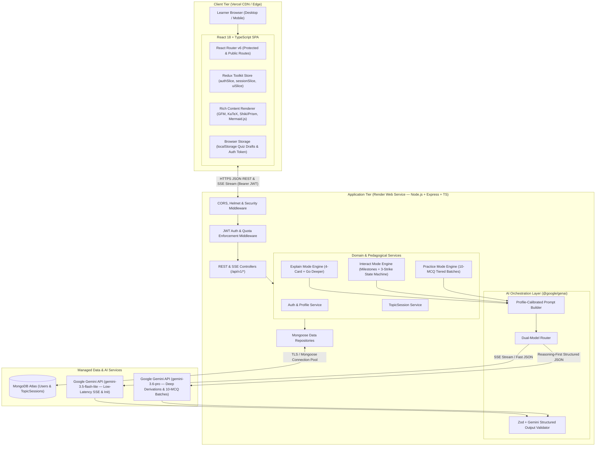

# Mentora

> An AI-powered personalized tutoring workspace that combines progressive concept breakdowns, milestone-driven Socratic dialogue, and tiered retrieval practice.

[](https://www.typescriptlang.org/)
[](https://react.dev/)
[](https://nodejs.org/)
[](https://expressjs.com/)
[](https://www.mongodb.com/atlas)
[](https://ai.google.dev/)
[](https://tailwindcss.com/)

---

## Overview

Mentora is a full-stack, cloud-native AI tutoring platform engineered for independent learners—including high school STEM students, university undergraduates, and upskilling software professionals—to systematically master complex academic and technical concepts within a unified single-page workspace. By binding session state to an active topic, Mentora enables learners to transition seamlessly across progressive conceptual breakdown, interactive Socratic dialogue, and rigorous multiple-choice assessment without context loss.

Traditional generative AI chat interfaces fail learners through unstructured walls of text, unguided Socratic loops that stall when a student is stuck, and hallucination-prone self-testing that reveals answers before problems are solved. Mentora overcomes these limitations by combining a persistent **Static Learner Profile** (`Education Level` $\times$ `Preferred Explanation Style`) with three deterministic pedagogical engines: **Explain Mode** (a 4-stage progressive disclosure sequence with recursive deep-dive sub-cards), **Interact Mode** (a milestone-oriented Socratic dialogue governed by a strict 3-Strike Circuit Breaker via Server-Sent Events), and **Practice Mode** (a tiered 10-MCQ assessment engine utilizing Reasoning-First structured outputs and $O(1)$ deterministic server-side grading).

---

## Demo

- Live Demo: [Mentora Live Workspace](#) *(placeholder link for Vercel deployment)*
- Backend API Health: [Mentora API Status](#) *(placeholder link for Render `/api/v1/health`)*

---

## Screenshots


---

## Features

- **Static Learner Profile Calibration:** Calibrates all tutoring prompts against a 2-step onboarding configuration combining 3 education levels (`High School`, `Undergraduate`, `Professional`) and 3 explanation styles (`Visual`, `Analogy-Heavy`, `Concise & Technical`) injected into every system instruction.
- **Explain Mode (Progressive Knowledge Encoding):** Deconstructs any topic into a 4-card progressive sequence (*Intuition $\rightarrow$ Core Mechanism $\rightarrow$ Example $\rightarrow$ Check-for-Understanding*) with instant, zero-quota client-side step progression and recursive on-demand `Go Deeper` sub-card expansion (up to 2 levels deep).
- **Interact Mode & 3-Strike Socratic Circuit Breaker:** Decomposes topics into 3–5 sequential conceptual milestones streamed over low-latency Server-Sent Events (SSE). It enforces a deterministic server-side state machine (`Strike 1: Nudge` $\rightarrow$ `Strike 2: Hint` $\rightarrow$ `Strike 3: Direct Explanation` and counter reset) alongside a manual escape hatch (`forceDirectExplanation: true`).
- **Practice Mode (Tiered 10-MCQ Retrieval):** Evaluates topic mastery across sequential **Easy $\rightarrow$ Medium $\rightarrow$ Hard** 10-question MCQ batches. Features real-time `localStorage` mid-quiz draft persistence, strict pre-submission answer-key masking, and deterministic $O(1)$ server-side grading upon batch completion.
- **Rich Technical Content Pipeline:** Renders complex academic material natively through GitHub Flavored Markdown (GFM), inline and display $\LaTeX$ equations via KaTeX (`$...$` and `$$...$$`), syntax-highlighted code blocks with copy utilities, and fault-tolerant `Mermaid.js` diagrams featuring syntax error fallbacks.
- **Educational Guardrails & Rolling Daily Quotas:** Intercepts out-of-scope or malicious queries before session initialization, returning structured HTTP `422 EDUCATIONAL_GUARDRAIL_REFUSAL` envelopes while enforcing a rolling 24-hour limit of 50 AI actions/day per user that preserves read-only session access when exhausted.

---

## Tech Stack

### Frontend (`@mentora/client`)
- React 18, Vite, TypeScript
- Redux Toolkit & React Router v6
- Tailwind CSS
- Native `fetch` + `ReadableStream` (SSE Client) & Axios
- `react-markdown`, `remark-gfm`, `remark-math`, `rehype-katex`, `mermaid`, Syntax Highlighter

### Backend (`@mentora/server`)
- Node.js 20 LTS, Express.js, TypeScript
- Official Google Gen AI SDK (`@google/genai`) with Dual-Model Routing (`GEMINI_FAST_MODEL` & `GEMINI_REASONING_MODEL`)
- Stateless JWT Bearer Authentication (`jsonwebtoken`, `bcryptjs`)
- Zod (Runtime Request, Env & Structured LLM Output Validation)
- Pino (Structured Logging), Helmet, CORS, `express-rate-limit`

### Shared Contracts (`@mentora/shared`)
- TypeScript Workspace Package & Zod Schemas (Single Source of Truth across Client & Server)

### Database
- MongoDB Atlas & Mongoose ODM (`User` and `TopicSession` models with multi-tenant isolation)

### Tools & Services
- pnpm Workspaces (Monorepo Management)
- Vitest, Supertest, `mongodb-memory-server`, React Testing Library
- Vercel (Frontend SPA Hosting) & Render (Backend Web Service)

---

## Architecture

Mentora is architected as a decoupled, 4-layer cloud-native system designed for type safety, state predictability, and low-latency interaction:
1. **Presentation & Client State Layer (`@mentora/client` — Vercel):** A responsive React SPA rendering unified tutoring workspaces, handling SSE stream decoders, and persisting active drafts to `localStorage`.
2. **Application & Pedagogical Orchestration Layer (`@mentora/server` — Render):** A stateless Express API enforcing JWT authentication, multi-tenant session isolation (`{ _id, userId }`), 24-hour rolling usage quotas, and deterministic pedagogical state machines.
3. **AI Orchestration & Dual-Model Router (Google Gemini API):** An isolated provider layer routing conversational and initialization tasks to `GEMINI_FAST_MODEL` (`gemini-3.5-flash-lite`) and complex derivations or 10-MCQ batches to `GEMINI_REASONING_MODEL` (`gemini-3.6-pro`) with strict schema validation.
4. **Persistence Layer (MongoDB Atlas):** Multi-tenant document storage encapsulating user profiles, rolling quota timestamps, and topic sessions containing cards, transcripts, and quiz batches.



---

## Project Structure

```text
mentora/
├── packages/
│   └── shared/               # @mentora/shared: Domain contracts, enums, constants, & Zod schemas
│       ├── package.json
│       ├── tsconfig.json
│       └── src/
│           ├── enums/        # EducationLevel, ExplanationStyle, LearningMode, PracticeTier
│           ├── schemas/      # Runtime Zod validation schemas for requests and LLM outputs
│           ├── types/        # Inferred TypeScript DTOs, API envelopes, and SSE payloads
│           └── constants/    # Business constants (DAILY_AI_QUOTA_LIMIT, MAX_SOCRATIC_STRIKES)
├── apps/
│   ├── server/               # @mentora/server: Node.js + Express + TypeScript backend
│   │   ├── package.json
│   │   ├── tsconfig.json
│   │   ├── .env.example
│   │   └── src/
│   │       ├── config/       # Zod-validated environment variables, MongoDB, and Pino logger
│   │       ├── middlewares/  # JWT auth, profile onboarding guard, quota, error handlers
│   │       ├── routes/       # Express REST & SSE routes (/api/v1/*)
│   │       ├── controllers/  # HTTP request/response handlers
│   │       ├── services/     # Pedagogical state machines (Explain, Interact, Practice)
│   │       ├── ai/           # @google/genai SDK, PromptBuilder, dual-model router, schemas
│   │       ├── models/       # Mongoose models (User.model.ts, TopicSession.model.ts)
│   │       ├── repositories/ # Multi-tenant isolated database queries
│   │       └── scripts/      # Standalone AI evaluation (eval-ai.ts) and live smoke verification
│   └── client/               # @mentora/client: React 18 + Vite + TypeScript frontend
│       ├── package.json
│       ├── tsconfig.json
│       ├── vite.config.ts
│       ├── .env.example
│       └── src/
│           ├── routes/       # AppRouter, ProtectedRoute, OnboardingGuard
│           ├── store/        # Redux Toolkit store, typed hooks, auth/session/ui slices
│           ├── services/     # Axios REST client and fetch-based SSE stream consumer
│           ├── components/   # WorkspaceShell, ExplainStage, InteractStage, PracticeStage
│           └── hooks/        # useSseStream, useQuizDraftPersistence, useQuotaStatus
├── docs/                     # Specifications, architecture blueprints, and visual assets
├── package.json              # Monorepo root scripts (build, test, lint, typecheck)
├── pnpm-workspace.yaml       # Monorepo workspace boundaries
└── tsconfig.base.json        # Shared strict TypeScript configuration
```

### Workspace Responsibilities
- **`packages/shared` (`@mentora/shared`):** The foundational contract layer defining all domain enums, Zod validation schemas, inferred TypeScript interfaces, and shared business constants, eliminating contract drift across frontend and backend boundaries.
- **`apps/server` (`@mentora/server`):** The backend web service executing deterministic pedagogical state machines, managing MongoDB Atlas persistence with multi-tenant isolation, and orchestrating Google Gemini API calls via `@google/genai`.
- **`apps/client` (`@mentora/client`):** The single-page web application providing the unified workspace interface, handling real-time Socratic SSE streaming, rendering rich mathematical/diagrammatic content, and managing client-side quiz drafts.

---

## Usage

### 1. Prerequisites & Installation
Ensure you have Node.js 20 LTS or later and `pnpm` installed:

```bash
# Clone the repository
git clone https://github.com/<your-username>/mentora.git
cd mentora

# Install monorepo dependencies across all workspaces
pnpm install
```

### 2. Environment Configuration
Create the `.env` configuration files for the backend and frontend workspaces using the provided templates:

#### Backend (`apps/server/.env`)
```bash
cp apps/server/.env.example apps/server/.env
```
Populate the required variables:
```dotenv
NODE_ENV=development
PORT=4000
MONGODB_URI=mongodb+srv://<username>:<password>@<cluster>.mongodb.net/mentora
JWT_SECRET=your-minimum-32-character-jwt-secret-key-here
JWT_EXPIRES_IN=7d
CLIENT_ORIGIN=http://localhost:5173
GEMINI_API_KEY=your-google-ai-studio-api-key
GEMINI_FAST_MODEL=gemini-3.5-flash-lite
GEMINI_REASONING_MODEL=gemini-3.6-pro
DAILY_AI_QUOTA_LIMIT=50
```

#### Frontend (`apps/client/.env`)
```bash
cp apps/client/.env.example apps/client/.env
```
Populate the API base URL:
```dotenv
VITE_API_BASE_URL=http://localhost:4000/api/v1
```

### 3. Building & Running Locally
Build the shared contract package first, then start the development servers:

```bash
# Build the @mentora/shared package
pnpm --filter @mentora/shared build

# Start the backend server (starts on http://localhost:4000)
pnpm --filter @mentora/server dev

# In a separate terminal, start the frontend dev server (starts on http://localhost:5173)
pnpm --filter @mentora/client dev
```

#### Running Verification Suites
```bash
# Run typechecking across all workspaces
pnpm typecheck

# Run ESLint across all workspaces
pnpm lint

# Run offline unit and integration test suites
pnpm test

# Run standalone AI quality evaluation suite (IMP-026)
pnpm eval:ai -- --dry-run
```

### 4. Application Workflow
1. **Onboarding & Profile Calibration:** Register an account and complete the initial onboarding modal by selecting your `Education Level` (`High School`, `Undergraduate`, or `Professional`) and `Preferred Explanation Style` (`Visual`, `Analogy-Heavy`, or `Concise & Technical`).
2. **Topic Initialization:** Enter any study or technical topic (e.g., *"Operating System Deadlocks"* or *"Binary Search Trees"*) on the Workspace dashboard.
3. **Exploration & Navigation:**
   - **Explain Mode:** Study the 4 progressive cards (*Intuition*, *Core Mechanism*, *Example*, *Check-for-Understanding*). Advance via **`Next`** without consuming quota, or click **`Go Deeper`** on complex steps to generate deeper sub-cards.
   - **Interact Mode:** Switch to the Interact tab to engage in an SSE-streamed Socratic dialogue across 3–5 conceptual milestones, guided by 3-strike nudges and hints or the direct explanation escape hatch.
   - **Practice Mode:** Complete the 10-question Easy MCQ batch. Questions persist automatically to browser storage; upon submission, the server executes instant deterministic grading, reveals solutions, and unlocks the Medium tier.

---

## What I Learned

- **Eliminating Full-Stack Contract Drift in a TypeScript Monorepo:** Designing `@mentora/shared` as a single source of truth using schema-first Zod definitions (`z.infer<typeof Schema>`) enabled total contract synchronization across client forms, REST controllers, `localStorage` hydration, and Gemini structured outputs, catching type discrepancies at compile time.
- **Deterministic State Machines Over Non-Deterministic LLMs:** Rather than trusting an LLM to reliably track turn counts and evaluate student comprehension autonomously, implementing the server-side **3-Strike Socratic Circuit Breaker** and parsing raw control headers (`<<MENTORA_STATE:...>>`) out of live Server-Sent Events (SSE) streams (`X-Accel-Buffering: no`) guaranteed sub-2s perceived latency while preserving absolute state predictability.
- **Autoregressive Schema Engineering (Reasoning-First MCQs):** Standard LLM JSON schemas often yield hallucinated or mismatched answer keys when declaring `correctOptionIndex` first. By enforcing a schema property sequence where `solutionExplanation` strictly precedes `correctOptionIndex`, the model is forced to generate a step-by-step mathematical and conceptual derivation before predicting the answer key.
- **Resilient Rich-Media Rendering & Multi-Tenant Security:** Engineering client-side markdown pipelines requires defensive isolation; wrapping `Mermaid.js` diagram rendering in parsing guards ensures malformed LLM syntax gracefully degrades to formatted code blocks rather than crashing the React tree. Combining this with strict `{ _id, userId }` database query filters and rolling 24-hour quota windows established a rock-solid multi-tenant security perimeter.

