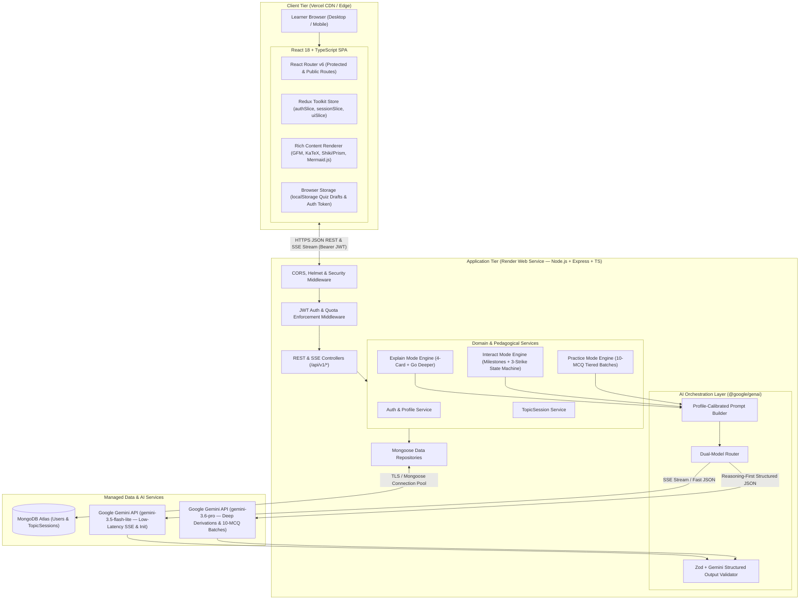
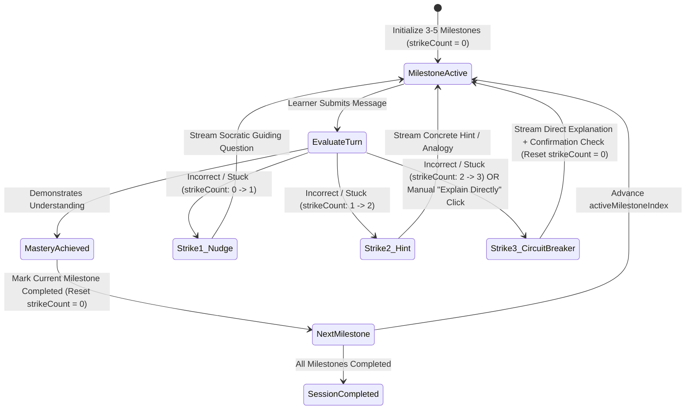
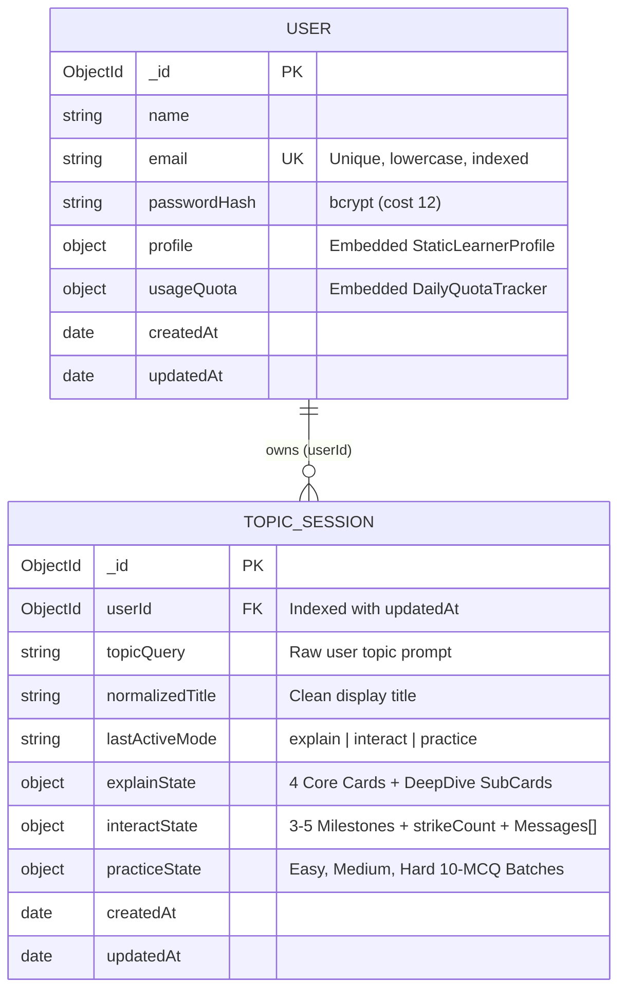

# System Architecture Document: Mentora

**Document Version:** 1.0.0 (MVP Baseline)  
**Product Name:** Mentora  
**Architecture Status:** Approved for Implementation  
**Target Stack:** React (TypeScript), Node.js + Express.js (TypeScript), MongoDB Atlas, Google Gemini API  
**Deployment Topology:** Vercel (Frontend SPA) + Render (Backend Web Service) + MongoDB Atlas (Managed Database)  

---

## A. Architecture Overview

### A.1 Architectural Philosophy & System Boundaries
Mentora is architected as a decoupled, type-safe, cloud-native **Single-Page Application (SPA) and REST/SSE API system** built on a unified **TypeScript Monorepo** (`npm`/`pnpm` workspaces). A shared contract package (`@mentora/shared`) serves as the single source of truth for runtime validation schemas (Zod), TypeScript interfaces, enumerations, and API payloads across the client and server.

The architecture is divided into four strict boundary layers:
1. **Presentation & Client State Layer (Frontend — Vercel):** A React 18+ TypeScript SPA styled with Tailwind CSS and managed via Redux Toolkit. It handles routing, progressive Explain card disclosure, real-time Server-Sent Events (SSE) stream consumption for Interact Mode, local mid-quiz draft persistence (`localStorage`), and rich technical rendering (Markdown, KaTeX for $\LaTeX$ math, syntax-highlighted code blocks, and Mermaid.js diagrams).
2. **Application & Pedagogical Orchestration Layer (Backend — Render):** A stateless Node.js + Express.js (TypeScript) server following a strict **Controller $\rightarrow$ Service $\rightarrow$ Repository / Provider** pattern. It enforces JWT authentication, daily per-user usage quotas, educational scope guardrails, and deterministic pedagogical state machines (such as the **3-Strike Socratic Circuit Breaker** and sequential **Easy $\rightarrow$ Medium $\rightarrow$ Hard** Practice tier unlocking).
3. **AI Tutoring & Structured Generation Layer (Google Gemini API):** An isolated integration boundary wrapping the official `@google/genai` SDK. It routes latency-sensitive conversational turns to `GEMINI_FAST_MODEL` (`gemini-3.5-flash-lite`) and complex STEM/assessment workloads to `GEMINI_REASONING_MODEL` (`gemini-3.6-pro`), enforcing strict JSON schemas (including Reasoning-First MCQ generation) and SSE streaming.
4. **Persistence Layer (Database — MongoDB Atlas):** A managed MongoDB cluster storing `User` accounts (with embedded Static Learner Profiles and rolling daily quota counters) and `TopicSession` documents (encapsulating Explain cards, Interact milestones/transcripts, and Practice MCQ batches).

### A.2 High-Level System Architecture Diagram



### A.3 Primary Request & Response Flows

1. **Explain Mode Flow (Structured JSON Request/Response):**
   * The client dispatches `POST /api/v1/sessions` (or `/explain/init`) with `{ topic, initialMode: 'explain' }`.
   * The backend verifies the user's JWT and daily quota (`< 50` actions/day), injects the user's **Static Learner Profile** (`educationLevel`, `preferredStyle`), and requests a 4-card structured JSON payload from Gemini (`Intuition`, `Core Mechanism`, `Example`, `Check-for-Understanding`).
   * The backend validates the JSON response against the shared Zod schema, persists the 4 cards inside `TopicSession.explainState`, increments the user's quota counter, and returns the session state. Advancing via **`Next`** is instantaneous on the client (updating `currentStepIndex`), while clicking **`Go Deeper`** triggers `POST /api/v1/sessions/:id/explain/deeper` to append a nested sub-card.
2. **Interact Mode Flow (Diagnostic Initialization + Real-Time SSE Turn Streaming):**
   * On first entry to the `Interact` tab, `POST /api/v1/sessions/:id/interact/init` generates 3 to 5 sequential conceptual milestones and an opening diagnostic question.
   * When the learner submits a reply via `POST /api/v1/sessions/:id/interact/stream`, the backend evaluates the user's message against the active milestone and current `strikeCount` (`0`, `1`, or `2`). It streams the tutor's response chunks via **Server-Sent Events (`text/event-stream`)** with proxy buffering disabled (`X-Accel-Buffering: no`) and emits a final `metadata` SSE event containing the updated `activeMilestoneIndex`, `milestoneStatus`, and `strikeCount`.
3. **Practice Mode Flow (Reasoning-First Batch Generation + Deterministic Evaluation):**
   * Entering the `Practice` tab invokes `POST /api/v1/sessions/:id/practice/generate` for `tier: 'easy'`.
   * The backend calls `GEMINI_REASONING_MODEL` with a strict JSON schema where `solutionExplanation` precedes `correctOptionIndex` for all 10 MCQs.
   * Before storing and returning the batch to the client, the backend strips `correctOptionIndex` and `solutionExplanation` from the active quiz payload (or marks the batch `in_progress` so answers remain hidden in the UI until submission).
   * Once the user selects answers for all 10 questions and calls `POST /api/v1/sessions/:id/practice/submit`, the backend grades all 10 answers deterministically in $O(1)$ time, unlocks the next difficulty tier (`medium` $\rightarrow$ `hard`), and returns the full review payload (`userAnswers`, `correctOptionIndex`, and `solutionExplanation`).

---

## B. Application Structure and Repository Organization

### B.1 Monorepo Workspace Strategy
To guarantee zero drift between frontend TypeScript interfaces, backend controller payloads, and Gemini structured output schemas, Mentora uses a **pnpm/npm Workspace Monorepo** containing three packages:
1. `packages/shared` (`@mentora/shared`): The single source of truth for Zod schemas, inferred TypeScript types, domain enums, error codes, and constants.
2. `apps/server` (`@mentora/server`): The Node.js + Express.js + TypeScript API server deployed to Render.
3. `apps/client` (`@mentora/client`): The React + Vite + TypeScript SPA deployed to Vercel.

### B.2 Directory Layout

```text
mentora/
├── package.json                   # Root workspace config & shared scripts (build, lint, test, typecheck)
├── tsconfig.base.json             # Base strict TypeScript configuration inherited by all workspaces
├── .gitignore
├── product_requirement.md         # Product Requirements Document (Source of Truth)
├── architecture.md                # System Architecture Document
│
├── packages/
│   └── shared/                    # @mentora/shared — Single Source of Truth for Contracts & Types
│       ├── package.json
│       ├── tsconfig.json
│       └── src/
│           ├── index.ts
│           ├── enums/             # EducationLevel, ExplanationStyle, LearningMode, PracticeTier, MilestoneStatus
│           ├── schemas/           # Zod validation schemas (auth, profile, explain, interact, practice)
│           ├── types/             # Inferred TS interfaces (DTOs, API envelopes, SSE event payloads)
│           └── constants/         # Quota limits (50/day), strike thresholds (3), batch sizes (10)
│
├── apps/
│   ├── server/                    # @mentora/server — Express + TypeScript Backend (Deployed on Render)
│   │   ├── package.json
│   │   ├── tsconfig.json
│   │   ├── .env.example
│   │   └── src/
│   │       ├── index.ts           # Entry point: DB connect, server bootstrap, graceful shutdown
│   │       ├── app.ts             # Express app configuration, CORS, Helmet, routes, error middleware
│   │       ├── config/            # Validated environment variables (env.ts), DB connection, logger (Pino)
│   │       ├── middlewares/       # auth.middleware.ts, quota.middleware.ts, validate.middleware.ts, error.middleware.ts
│   │       ├── routes/            # v1 route definitions (auth, profile, sessions, explain, interact, practice, health)
│   │       ├── controllers/       # Thin HTTP/SSE request & response handlers
│   │       ├── services/          # Core business & pedagogical logic
│   │       │   ├── auth.service.ts
│   │       │   ├── session.service.ts
│   │       │   ├── explain.service.ts
│   │       │   ├── interact.service.ts
│   │       │   └── practice.service.ts
│   │       ├── ai/                # Google Gemini Integration Layer
│   │       │   ├── gemini.client.ts
│   │       │   ├── model.router.ts
│   │       │   ├── prompts/       # System prompt builders (profile injection, guardrails, mode templates)
│   │       │   └── schemas/       # Gemini responseSchema definitions mapped to @mentora/shared
│   │       ├── models/            # Mongoose schemas & models (User.model.ts, TopicSession.model.ts)
│   │       ├── repositories/      # Data access abstraction over Mongoose models
│   │       └── utils/             # AppError class, asyncHandler wrapper, SSE stream helper
│   │
│   └── client/                    # @mentora/client — React + Vite + TS Frontend (Deployed on Vercel)
│       ├── package.json
│       ├── tsconfig.json
│       ├── vite.config.ts
│       ├── index.html
│       ├── .env.example
│       └── src/
│           ├── main.tsx
│           ├── App.tsx
│           ├── routes/            # AppRouter.tsx, ProtectedRoute.tsx, OnboardingGuard.tsx
│           ├── store/             # Redux Toolkit store, typed hooks, slices (authSlice, sessionSlice, uiSlice)
│           ├── services/          # Axios API client, JWT interceptors, Fetch SSE stream client
│           ├── pages/             # LoginPage, RegisterPage, OnboardingPage, WorkspacePage
│           ├── components/
│           │   ├── layout/        # AppShell, LeftHistorySidebar, StickyTopicHeader, ModeSwitcherTabs, QuotaBadge
│           │   ├── common/        # RichMarkdownRenderer, MermaidDiagram, KaTeXBlock, CodeBlock, ErrorBoundary
│           │   ├── explain/       # ExplainStage, StepProgressBar, ExplainCard, DeepDiveSubCard, CardControls
│           │   ├── interact/      # InteractStage, MilestoneTrackerBar, ChatTranscript, StreamingBubble, ChatInput
│           │   └── practice/      # PracticeStage, TierSelectorBar, McqQuestionCard, BatchReviewView, PracticeSummary
│           ├── hooks/             # useSseStream.ts, useQuizDraftPersistence.ts, useQuotaStatus.ts
│           └── utils/             # LocalStorage helpers, formatters
```

### B.3 Separation of Concerns & Module Boundaries
* **UI Components (`apps/client/src/components`)** never construct raw HTTP URLs or manipulate JWT tokens directly; they dispatch Redux thunks/actions or invoke custom hooks.
* **Controllers (`apps/server/src/controllers`)** contain zero business logic or database queries; they extract validated inputs (`req.body`, `req.params`, `req.user`), invoke a single Domain Service method, and format the HTTP/SSE response.
* **Domain Services (`apps/server/src/services`)** enforce all business rules (`BR-01` through `BR-04`), coordinate between Repositories and the AI Layer, and are 100% unit-testable with mocked AI/Repository interfaces.
* **AI Layer (`apps/server/src/ai`)** encapsulates `@google/genai` SDK calls, prompt templates, and JSON schema enforcement. No other backend layer imports `@google/genai`.

---

## C. Frontend Architecture

### C.1 Routing & Guard Hierarchy
Mentora uses **React Router v6** with two declarative route guards that enforce `FR-001`, `FR-002`, and `BR-01`:
1. **`/login` & `/register` (`PublicOnlyGuard`):** Redirects authenticated users directly to `/workspace` (or `/onboarding` if their profile is incomplete).
2. **`/onboarding` (`ProtectedRoute`):** Accessible only to authenticated users. Presents the mandatory 2-step **Static Learner Profile** setup (`Education Level` + `Preferred Explanation Style`). Once completed (`user.profile.isCompleted === true`), redirects to `/workspace`.
3. **`/workspace` & `/workspace/:sessionId` (`ProtectedRoute` + `OnboardingGuard`):** If an authenticated user has `user.profile.isCompleted === false`, `OnboardingGuard` intercepts navigation and redirects them to `/onboarding` (`BR-01`).

### C.2 State Management Strategy (Redux Toolkit + LocalStorage)
To keep state predictable across mode switches (`FR-005`) and session reloads (`FR-006`), client state is partitioned into three Redux Toolkit slices plus targeted local persistence:
1. **`authSlice`:** Stores `user` (id, name, email, `profile`), `token` (hydrated from `localStorage`), `quota` (`dailyCount`, `dailyLimit`, `windowResetAt`), and `authStatus`.
2. **`sessionSlice`:**
   * `sessionList`: Lightweight array of sidebar history items (`_id`, `normalizedTitle`, `lastActiveMode`, `updatedAt`).
   * `activeSession`: Full `TopicSessionDTO` for the currently open session (`explainState`, `interactState`, `practiceState`).
   * `activeMode`: `'explain' | 'interact' | 'practice'` (synchronized with the top Mode Switcher tabs).
   * `streamingState`: Tracks active SSE streaming status (`isStreaming`, `streamBuffer`, `streamError`) for Interact Mode without mutating historical messages until turn completion.
3. **`uiSlice`:** Controls collapsible Left Sidebar drawer state (desktop vs. mobile viewport), Profile Settings modal visibility, and toast notifications.
4. **Mid-Quiz Local Persistence (`useQuizDraftPersistence`):** Per `Edge Case 5`, while a user is answering an unsubmitted 10-MCQ batch in Practice Mode, every option selection (`A`, `B`, `C`, `D`) is immediately written to `localStorage` under `mentora_quiz_draft_${sessionId}_${tier}`. If the user refreshes the page or toggles between `Explain`, `Interact`, and `Practice` tabs mid-quiz, their selected options are restored seamlessly. Upon batch submission, the draft key is cleared.

### C.3 Rich Technical Content Rendering Pipeline (`FR-009`)
All three learning modes share a unified, memoized `<RichMarkdownRenderer content={markdown} />` component:
* **Markdown & Tables:** `react-markdown` + `remark-gfm`.
* **Mathematical Notation ($\LaTeX$):** `remark-math` + `rehype-katex` (bundled with `katex/dist/katex.min.css`) supporting both inline `$...$` and display `$$...$$` notation at scalable font sizes (`NFR-004`).
* **Syntax-Highlighted Code:** Custom `code` renderer mapping fenced code blocks to `react-syntax-highlighter` (or `shiki`) with language badge and 1-click Copy button.
* **Resilient Visual Diagrams (`Edge Case 3`):** Fenced ````mermaid` blocks are routed to a dedicated `<MermaidDiagram code={rawCode} />` component. It runs `mermaid.parse(rawCode)` inside a `try/catch` block before rendering an SVG. If the AI emits malformed diagram syntax, the component gracefully falls back to a clean, styled preformatted code/diagram block without triggering a React crash or breaking the card layout.

### C.4 SSE Streaming Client for Interact Mode (`FR-011`, `NFR-001`)
Because standard browser `EventSource` only supports `GET` requests and cannot easily attach `Authorization: Bearer <token>` headers or JSON request bodies, the frontend implements SSE streaming over native `fetch()` + `ReadableStream` (`@microsoft/fetch-event-source` pattern):
* Parses incoming `event: token`, `event: metadata`, and `event: error` frames.
* Appends text deltas into Redux `streamingState.streamBuffer` at 60fps for smooth rendering.
* If a network drop occurs mid-stream (`Edge Case 4`), sets `streamingState.streamError = true` and displays an inline **"Connection interrupted — Retry"** action that re-sends the user's message payload without incrementing their Socratic strike count.

---

## D. Backend Architecture

### D.1 Layered Express Architecture
The Express.js (TypeScript) backend enforces a strict 4-layer dependency hierarchy:
1. **HTTP / Middleware Layer (`app.ts`, `routes/`, `middlewares/`):**
   * `helmet()` for secure HTTP headers.
   * `cors({ origin: env.CLIENT_ORIGIN, credentials: true, allowedHeaders: ['Content-Type', 'Authorization'] })` for split-domain Vercel $\leftrightarrow$ Render communication.
   * `authMiddleware`: Extracts and verifies the JWT from `Authorization: Bearer <token>`, attaching `req.user = { id, email, profile }`.
   * `quotaMiddleware`: Enforces `BR-04` and `FR-018` on all AI generation endpoints.
   * `validateMiddleware(zodSchema)`: Validates `req.body`, `req.params`, and `req.query` against shared `@mentora/shared` Zod schemas before reaching any controller.
2. **Controller Layer (`controllers/`):** Translates Express `Request`/`Response` objects into typed service calls. For `/interact/stream`, sets unbuffered SSE headers (`Content-Type: text/event-stream`, `Cache-Control: no-cache, no-transform`, `Connection: keep-alive`, `X-Accel-Buffering: no`) and flushes headers immediately.
3. **Domain Service Layer (`services/`):** Implements the core state machines for Explain, Interact, and Practice modes, enforces sequential tier unlocking (`BR-02`) and full-batch submission rules (`BR-03`), and coordinates atomic updates via Repositories.
4. **Repository & Integration Layer (`repositories/`, `ai/`):** Isolates Mongoose queries and `@google/genai` SDK calls behind clean TypeScript interfaces.

### D.2 Centralized Error Handling & Logging
* **`AppError` Hierarchy:** Operational errors throw a typed `AppError(statusCode, errorCode, message, details?)` (e.g., `400 VALIDATION_ERROR`, `401 UNAUTHORIZED`, `403 PROFILE_INCOMPLETE`, `422 EDUCATIONAL_GUARDRAIL_REFUSAL`, `429 DAILY_QUOTA_EXCEEDED`, `502 AI_UPSTREAM_FAILURE`).
* **Global Error Middleware:** Catches all operational `AppError` instances, Zod validation errors, and unexpected exceptions, logging structured JSON via **Pino** (with request correlation IDs and redacted sensitive fields) and returning a uniform JSON error envelope.

### D.3 Rate Limiting & Daily Quota Enforcement (`FR-018`, `BR-04`)
Mentora implements two complementary rate-limiting layers:
1. **Infrastructure Abuse Protection (`express-rate-limit`):** IP/User burst limiter (e.g., max 60 API requests/minute) to prevent brute-force login attempts or script flooding.
2. **Persistent Daily AI Usage Quota (`quota.middleware.ts`):**
   * Stored atomically on the `User` document (`usageQuota.dailyCount` and `usageQuota.windowResetAt`).
   * Before any AI generation call (`Explain Init`, `Explain Go Deeper`, `Interact Init`, `Interact Turn`, `Practice Batch Generate`), the middleware checks if `now >= windowResetAt`. If so, it resets `dailyCount = 0` and sets `windowResetAt` to the next 24-hour boundary.
   * If `dailyCount >= env.DAILY_AI_QUOTA_LIMIT` (default: `50`), the request is rejected with `429 DAILY_QUOTA_EXCEEDED` and `{ resetAt: windowResetAt }`. Read-only endpoints (`GET /sessions`, `GET /sessions/:id`, `POST /practice/submit` for already-generated batches) are never blocked by the AI quota, satisfying `BR-04`.

---

## E. AI Tutoring Architecture

### E.1 Shared Pedagogical Context & Prompt Engineering Engine
Every call to the Google Gemini API is constructed by the **`PromptBuilder`** service, which injects three universal layers into the `systemInstruction`:
1. **Educational Scope & Safety Guardrail (`FR-018`, `Edge Case 1`):** Instructs the model that it is Mentora, an academic and skill-building AI tutor. If a topic or user prompt requests harmful, illegal, unethical, or non-educational tasks (e.g., writing spam, malware, or social media bios), the model must set `isEducationalValid: false` and provide a polite educational refusal notice.
2. **Static Learner Profile Calibration (`FR-002`, `Section 8.1`):** Dynamically injects the learner's persisted profile matrix:
   * **Education Level (`high_school` | `undergraduate` | `professional`):** Governs vocabulary complexity, assumed mathematical/scientific prerequisites, and problem context.
   * **Preferred Explanation Style (`visual` | `analogy_heavy` | `concise_technical`):**
     * `visual`: Mandates Mermaid.js flowcharts/sequence diagrams (````mermaid`) and Markdown comparison tables.
     * `analogy_heavy`: Leads every concept with a concrete, everyday metaphor before introducing formal notation.
     * `concise_technical`: Eliminates conversational filler, prioritizing formal definitions, $\LaTeX$ derivations, code implementations, and edge cases.
3. **Formatting Rules (`FR-009`):** Enforces strict inline `$...$` and block `$$...$$` $\LaTeX$ syntax for all math/scientific formulas, language-tagged fenced code blocks, and quoted node labels in Mermaid.js (`A["Label"]`) to prevent parser errors.

### E.2 Dual-Model Routing Matrix
| Mode & Operation | Routed Model (`env`) | Default Gemini Model ID | Output Mode | Architectural Rationale |
| :--- | :--- | :--- | :--- | :--- |
| **Explain Mode — 4-Card Init** | `GEMINI_FAST_MODEL` | `gemini-3.5-flash-lite` | Structured JSON (`responseSchema`) | Generates all 4 core cards in a single call within ~3–5s so subsequent `Next` clicks have zero latency. |
| **Explain Mode — `Go Deeper`** | `GEMINI_REASONING_MODEL` | `gemini-3.6-pro` | Structured JSON (`responseSchema`) | Requires deep technical derivations, formal proofs, or architectural diagrams for a specific card. |
| **Interact Mode — Milestone Init** | `GEMINI_FAST_MODEL` | `gemini-3.5-flash-lite` | Structured JSON (`responseSchema`) | Decomposes the topic into 3–5 sequential milestones and crafts the opening diagnostic question. |
| **Interact Mode — Socratic Turn** | `GEMINI_FAST_MODEL` | `gemini-3.5-flash-lite` | Streaming (`generateContentStream`) | Guarantees P90 Time-to-First-Token (TTFT) $< 2.0\text{s}$ (`NFR-001`) during live conversation. |
| **Practice Mode — 10-MCQ Batch** | `GEMINI_REASONING_MODEL` | `gemini-3.6-pro` | Structured JSON (`responseSchema`) | Requires multi-step derivation verification across 10 questions to guarantee $\ge 99\%$ answer key validity (`NFR-003`). |

### E.3 Mode 1: Explain Mode Engine (`FR-007`, `FR-008`)
* **Responsibility:** Encode knowledge progressively across 4 deterministic pedagogical steps (`1. Intuition` $\rightarrow$ `2. Core Mechanism` $\rightarrow$ `3. Example` $\rightarrow$ `4. Check-for-Understanding`) with on-demand vertical depth (`Go Deeper`).
* **Inputs:** `topicQuery`, `StaticLearnerProfile`, and (for `Go Deeper`) the parent card's `stepType`, `title`, `contentMarkdown`, and existing `deepDives` count.
* **Outputs:**
  * On initialization: A validated 4-element `ExplainCard[]` array persisted to `TopicSession.explainState.cards`, with `currentStepIndex` set to `0` (so only Card 1 is visible initially, per `AC-EXP-01`).
  * On `Next`: Client increments `currentStepIndex` (up to `3`) and syncs via `PATCH /api/v1/sessions/:id/explain/progress`.
  * On `Go Deeper`: Appends a `DeepDiveSubCard` (`depthLevel`, `title`, `contentMarkdown`) directly into `explainState.cards[stepIndex].deepDives[]` without resetting `currentStepIndex` (`AC-EXP-03`).

### E.4 Mode 2: Interact Mode Engine & 3-Strike Socratic Circuit Breaker (`FR-010`–`FR-013`)
* **Responsibility:** Guide the learner through 3–5 explicit conceptual milestones via Socratic dialogue while preventing infinite questioning loops using a deterministic server-side state machine.
* **State Machine & Turn Evaluation Flow:**



* **Streaming + State Evaluation Protocol:**
  * When `POST /api/v1/sessions/:id/interact/stream` is called (or when the learner clicks the manual **"Explain this milestone directly"** control per `FR-013`), the `InteractService` passes the active milestone, current `strikeCount`, and recent conversation history to `GEMINI_FAST_MODEL`.
  * To simultaneously achieve `< 2.0s` text streaming (`NFR-001`) and deterministic milestone/strike transitions, the system prompt instructs the model to emit a single compact control header on the first line:
    `<<MENTORA_STATE:{"outcome":"ADVANCE"|"STRIKE"|"CIRCUIT_BREAKER_ACK"}>>`
    followed immediately by the natural markdown response stream.
  * The server strips the `<<MENTORA_STATE:...>>` header from the outgoing text stream, computes the exact next state deterministically on the backend:
    * If `outcome === "ADVANCE"`: Marks `milestones[activeIndex].status = 'completed'`, increments `activeMilestoneIndex`, resets `strikeCount = 0`.
    * If `outcome === "STRIKE"` and incoming `strikeCount < 2`: Increments `strikeCount` (`1` or `2`).
    * If `outcome === "STRIKE"` and incoming `strikeCount === 2` (i.e., **Strike 3** reached) or `forceDirectExplanation === true`: Triggers the Circuit Breaker, delivers the direct explanation, and resets `strikeCount = 0`.
  * Once the text stream finishes, the backend persists the turn to MongoDB and sends a final `event: metadata` SSE frame with the updated milestone tracker and strike state.

### E.5 Mode 3: Practice Mode Engine & Reasoning-First Verification (`FR-014`–`FR-017`, `NFR-003`)
* **Responsibility:** Generate and evaluate 10-question MCQ batches across 3 sequential difficulty tiers (`Easy` $\rightarrow$ `Medium` $\rightarrow$ `Hard`) with 100% structural and mathematical consistency.
* **Reasoning-First Schema Enforcement (`FR-017`):**
  * Autoregressive LLMs generate tokens sequentially. If `correctOptionIndex` is placed before `solutionExplanation` in the JSON schema, the model guesses an index first and attempts to rationalize it later, causing answer-key mismatches.
  * Mentora's Gemini `responseSchema` mandates the exact property generation order:
    1. `questionNumber` (`1` to `10`)
    2. `questionText` (Markdown + $\LaTeX$ + Code stem)
    3. `options` (4 distinct strings `[A, B, C, D]`)
    4. `hint` (On-demand conceptual clue)
    5. `solutionExplanation` (**Generated BEFORE the answer key**: step-by-step derivation proving why the correct option is valid and why distractors fail)
    6. `correctOptionIndex` (`0`, `1`, `2`, or `3` matching the completed derivation above)
* **Post-Generation Verification & Sanitization:**
  * The backend validates the returned JSON via Zod (`questions.length === 10`, every `options.length === 4`, `0 <= correctOptionIndex <= 3`). If validation fails, the service automatically retries once before returning an error.
  * While a batch's status is `'in_progress'`, API responses to the client omit `correctOptionIndex` and `solutionExplanation` (`BR-03`), preventing users from inspecting network payloads prior to submitting all 10 answers.

---

## F. Data Architecture

### F.1 Entity-Relationship Diagram



### F.2 MongoDB Collection Specifications

#### 1. `users` Collection
* **Purpose:** Stores learner credentials, the mandatory Static Learner Profile (`FR-002`), and rolling daily AI usage quota counters (`FR-018`).
* **Ownership & Access Rules:** Strictly private to the authenticated user (`_id === req.user.id`). `passwordHash` is excluded by default (`select: false`) in Mongoose queries.
* **Key Fields & Validation:**
  * `name`: `String`, required, trimmed, `2–80` chars.
  * `email`: `String`, required, unique, lowercase, valid email regex.
  * `passwordHash`: `String`, required.
  * `profile`:
    * `isCompleted`: `Boolean` (default: `false`).
    * `educationLevel`: Enum `['high_school', 'undergraduate', 'professional']` (nullable until onboarding completes).
    * `preferredStyle`: Enum `['visual', 'analogy_heavy', 'concise_technical']` (nullable until onboarding completes).
  * `usageQuota`:
    * `dailyCount`: `Number` (default: `0`, min: `0`).
    * `windowResetAt`: `Date` (default: 24h from creation).
* **Indexes:**
  * `{ email: 1 }` — Unique index.

#### 2. `topicsessions` Collection
* **Purpose:** Single cohesive document representing a learner's end-to-end study session across Explain, Interact, and Practice modes (`FR-004`, `FR-005`, `FR-006`). Embedding all three mode states inside one `TopicSession` document guarantees atomic reads/writes when switching tabs and avoids costly multi-collection joins.Document size is bounded (~40–80 KB per complete session, well below MongoDB's 16 MB limit).
* **Ownership & Access Rules:** Every query (`findOne`, `updateOne`, `deleteOne`) must filter by `{ _id: sessionId, userId: req.user.id }` (`NFR-005`).
* **Key Sub-Document Structures:**
  * **`explainState`:**
    * `status`: `'not_started' | 'ready'`
    * `currentStepIndex`: `Number` (`0` to `3`, tracking progressive disclosure up to Card 4).
    * `cards`: Array of 4 `ExplainCard` objects (`stepNumber: 1..4`, `stepType`, `title`, `contentMarkdown`, `checkQuestion?`, `checkAnswer?`, `deepDives: Array<{ id, title, contentMarkdown, createdAt }>`).
    * `suggestedSubTopics`: `String[]` (populated on broad topics per `Edge Case 2`).
  * **`interactState`:**
    * `status`: `'not_started' | 'active' | 'completed'`
    * `activeMilestoneIndex`: `Number` (`0` to `milestones.length - 1`).
    * `strikeCount`: `Number` (`0`, `1`, or `2`).
    * `milestones`: Array of 3–5 objects (`milestoneNumber`, `title`, `description`, `status: 'pending' | 'active' | 'completed'`).
    * `messages`: Array of chat turns (`id`, `role: 'user' | 'assistant'`, `content`, `milestoneNumber`, `strikeNumberAtTurn`, `isCircuitBreakerExplanation`, `createdAt`).
  * **`practiceState`:**
    * `activeTier`: `'easy' | 'medium' | 'hard'` (default: `'easy'`).
    * `batches`: Object keyed by `easy`, `medium`, and `hard`, where each `PracticeBatch` contains:
      * `tier`: `'easy' | 'medium' | 'hard'`
      * `status`: `'locked' | 'not_started' | 'in_progress' | 'completed'` (Initial states: `easy = 'not_started'`, `medium = 'locked'`, `hard = 'locked'` per `BR-02`).
      * `score`: `Number | null` (`0–10` once completed).
      * `questions`: Array of 10 `McqQuestion` objects (`questionNumber: 1..10`, `questionText`, `options: [string, string, string, string]`, `hint`, `solutionExplanation`, `correctOptionIndex: 0..3`).
      * `userAnswers`: Array of 10 numbers (`0..3`) populated upon batch submission.
      * `completedAt`: `Date | null`.
* **Indexes:**
  * `{ userId: 1, updatedAt: -1 }` — Compound index supporting fast Left Sidebar history listing (`FR-006`).
  * `{ _id: 1, userId: 1 }` — Enforces fast ownership lookups.

---

## G. API Design and Data Contracts

### G.1 API Versioning & Envelope Conventions
All endpoints are prefixed with `/api/v1`.
* **Standard JSON Success Envelope:**
  ```json
  {
    "success": true,
    "data": { ... },
    "meta": {
      "quota": { "used": 12, "limit": 50, "resetAt": "2026-10-24T00:00:00.000Z" }
    }
  }
  ```
* **Standard JSON Error Envelope:**
  ```json
  {
    "success": false,
    "error": {
      "code": "DAILY_QUOTA_EXCEEDED",
      "message": "You have reached your daily limit of 50 tutor actions. You can still review all saved sessions.",
      "details": { "resetAt": "2026-10-24T00:00:00.000Z" }
    }
  }
  ```

### G.2 Endpoint Catalog

| Group | Method & Path | Auth & Guards | Responsibility |
| :--- | :--- | :--- | :--- |
| **System** | `GET /api/v1/health` | Public | Returns `{ status: 'ok', uptime }` to wake Render instance and verify MongoDB connectivity. |
| **Auth** | `POST /api/v1/auth/register` | Public | Registers user (`name`, `email`, `password`), returns JWT + `UserDTO` (`profile.isCompleted: false`). |
| **Auth** | `POST /api/v1/auth/login` | Public | Verifies credentials, returns JWT + `UserDTO`. |
| **Auth** | `GET /api/v1/auth/me` | JWT | Returns current authenticated `UserDTO` and live `usageQuota` counter. |
| **Profile** | `PUT /api/v1/profile` | JWT | Saves/updates Static Learner Profile (`educationLevel`, `preferredStyle`) and sets `isCompleted = true` (`FR-002`, `FR-003`). |
| **Sessions** | `GET /api/v1/sessions` | JWT + Profile | Lists user's saved `TopicSession` summaries sorted by `updatedAt DESC` for the Left Sidebar (`FR-006`). |
| **Sessions** | `POST /api/v1/sessions` | JWT + Profile + Quota | Creates a new `TopicSession` for `{ topicQuery, initialMode }` and automatically initializes the selected mode (`FR-004`). |
| **Sessions** | `GET /api/v1/sessions/:id` | JWT + Profile | Returns full `TopicSessionDTO` (with unsubmitted Practice answer keys masked per `BR-03`). |
| **Sessions** | `PATCH /api/v1/sessions/:id/mode` | JWT + Profile | Updates `lastActiveMode` (`explain` \| `interact` \| `practice`) when switching tabs (`FR-005`). |
| **Sessions** | `DELETE /api/v1/sessions/:id` | JWT + Profile | Permanently deletes a saved `TopicSession` (`FR-006`). |
| **Explain** | `POST /api/v1/sessions/:id/explain/init` | JWT + Profile + Quota | Generates the 4 core Explain cards if `explainState.status === 'not_started'` (`FR-007`). |
| **Explain** | `PATCH /api/v1/sessions/:id/explain/step` | JWT + Profile | Advances `currentStepIndex` when user clicks `Next` (`FR-008`, `AC-EXP-02`). |
| **Explain** | `POST /api/v1/sessions/:id/explain/deeper`| JWT + Profile + Quota | Generates and appends a `Go Deeper` sub-card under `stepNumber` (`1..4`) (`FR-008`, `AC-EXP-03`). |
| **Interact** | `POST /api/v1/sessions/:id/interact/init` | JWT + Profile + Quota | Generates 3–5 conceptual milestones and opening diagnostic prompt (`FR-010`, `AC-INT-01`). |
| **Interact** | `POST /api/v1/sessions/:id/interact/stream`| JWT + Profile + Quota | Accepts `{ message, forceDirectExplanation? }`, runs 3-Strike state machine, streams SSE response (`FR-011`–`FR-013`). |
| **Practice** | `POST /api/v1/sessions/:id/practice/generate` | JWT + Profile + Quota | Generates 10 MCQs for `{ tier: 'easy' \| 'medium' \| 'hard' }` if unlocked (`FR-014`, `BR-02`). |
| **Practice** | `POST /api/v1/sessions/:id/practice/submit` | JWT + Profile | Accepts `{ tier, answers: number[10] }`, grades batch, reveals explanations, and unlocks next tier (`FR-016`, `BR-03`). |

### G.3 SSE Streaming Protocol Specification (`POST /api/v1/sessions/:id/interact/stream`)
The endpoint emits standard SSE frames:
1. **`event: start`** — `{ "turnId": "uuid", "activeMilestoneIndex": 1 }`
2. **`event: token`** — `{ "delta": "Let's think about what happens when Process A holds Lock 1..." }` (emitted repeatedly as Gemini streams tokens)
3. **`event: metadata`** — `{ "activeMilestoneIndex": 1, "strikeCount": 1, "milestones": [...], "isCompleted": false, "quota": { ... } }` (emitted once after stream completion and DB write)
4. **`event: done`** — `[DONE]`
5. **`event: error`** — `{ "code": "STREAM_INTERRUPTED", "message": "..." }` (if upstream error occurs; does not increment `strikeCount`)

---

## H. Security, Privacy, and Infrastructure Topology

### H.1 Cross-Origin Authentication (Vercel + Render Compatibility)
* Because the React frontend is hosted on Vercel (`https://mentora.vercel.app`) and the Express API is hosted on Render (`https://mentora-api.onrender.com`), browser Intelligent Tracking Prevention (ITP) on Safari and Brave aggressively blocks cross-site `SameSite=None` cookies across different root domains.
* **Confirmed Architecture Decision:** Mentora uses **Stateless JWT Bearer Authentication** (`Authorization: Bearer <jwt>`) signed with `HS256` (`JWT_SECRET`, 7-day expiry) paired with strict CORS origin validation (`FRONTEND_URL`).
* Passwords are hashed using `bcryptjs` with a salt work factor of `12` (`NFR-005`).
* Every database query on `TopicSession` is scoped by `{ _id: req.params.id, userId: req.user.id }` to guarantee strict multi-tenant user isolation (`NFR-005`).

### H.2 Cloud Deployment & Cold-Start Mitigation
* **Frontend (Vercel):** Built from `apps/client` (building `@mentora/shared` first) and served globally via Vercel's Edge Network with `vercel.json` SPA fallback rewrites (`/* -> /index.html`).
* **Backend (Render Web Service):** Deployed from `apps/server` with Node 20 LTS.
  * *Cold-Start Mitigation:* Render starter/free instances spin down after inactivity. When the React app loads `/login`, `/register`, or `/workspace`, it fires a non-blocking background request to `GET /api/v1/health` so the Render container wakes up while the user enters their credentials or topic.
  * *SSE Keep-Alive:* During `/interact/stream`, the server sends a `: keepalive\n\n` SSE comment every 15 seconds if waiting on upstream tokens to prevent proxy idle timeouts.
* **Database (MongoDB Atlas):** Deployed in the same cloud region as the Render Web Service (e.g., `us-east-1` or `ap-south-1`) to keep database round-trip latency under `10ms`.

---

## L. Testing Strategy

### L.1 Deterministic Unit & Integration Tests (Vitest + Supertest + MongoDB Memory Server)
1. **Shared Schema & Contract Tests (`packages/shared`):**
   * Verify Zod schemas reject malformed MCQ batches (e.g., 9 questions instead of 10, `correctOptionIndex: 4`, or missing `solutionExplanation`) and validate profile enums.
2. **Pedagogical State Machine Unit Tests (`apps/server`):**
   * **3-Strike Socratic Circuit Breaker (`AC-INT-02`):** Deterministically test `InteractService` with a mocked Gemini provider across 3 consecutive `"STRIKE"` outcomes, asserting that Turn 1 sets `strikeCount = 1` (Nudge prompt), Turn 2 sets `strikeCount = 2` (Hint prompt), and Turn 3 triggers the Circuit Breaker explanation and resets `strikeCount = 0`.
   * **Practice Mode Tier Unlocking & Answer Masking (`AC-PRC-01`–`03`, `BR-02`, `BR-03`):** Verify that a new session locks `medium` and `hard`, masks `correctOptionIndex` while `status === 'in_progress'`, rejects submission payloads with fewer than 10 answers, accurately computes scores ($0\text{–}10$), reveals explanations upon submission, and unlocks the subsequent tier.
   * **Daily Usage Quota Middleware (`BR-04`):** Verify that action #50 succeeds, action #51 returns `429 DAILY_QUOTA_EXCEEDED`, and `GET /api/v1/sessions/:id` remains accessible when quota is exhausted.
3. **API Integration Tests (`Supertest` + `mongodb-memory-server`):**
   * End-to-end HTTP tests covering registration $\rightarrow$ onboarding guard enforcement (`BR-01`) $\rightarrow$ profile setup $\rightarrow$ session creation $\rightarrow$ cross-user isolation checks (`User B` attempting to read `User A`'s session receives `404`).
4. **Frontend Component & Workflow Tests (Vitest + React Testing Library):**
   * Test Explain Mode progressive card stepping (`Next` reveals Card $N+1$, `Go Deeper` renders nested sub-card).
   * Test `<MermaidDiagram />` error boundary fallback when passed invalid Mermaid syntax (`Edge Case 3`).
   * Test Practice Mode `localStorage` draft restoration across simulated page reloads (`Edge Case 5`).

### L.2 Non-Deterministic AI Quality Evaluations (Offline Eval Suite)
Because live LLM outputs vary across runs, AI quality is evaluated separately from CI unit tests via an on-demand evaluation script (`pnpm --filter @mentora/server eval:ai`):
* Runs 15 benchmark topics (spanning High School Biology, Undergraduate Operating Systems, and Professional Distributed Systems) across all 6 profile combinations.
* Measures **Structured JSON First-Pass Validity Rate** (Target: $\ge 99.0\%$) and verifies that generated `solutionExplanation` derivations logically match the selected `correctOptionIndex` (`FR-017`).

---

## M. Development Standards and Implementation Boundaries

### M.1 TypeScript Strictness & Shared Single Source of Truth
* `tsconfig.base.json` enforces `"strict": true`, `"noImplicitAny": true`, `"strictNullChecks": true`, and `"noUncheckedIndexedAccess": true`.
* **Zero Duplicate Interfaces Rule:** Neither `apps/client` nor `apps/server` may define local interfaces for domain entities (`User`, `StaticLearnerProfile`, `TopicSession`, `ExplainCard`, `InteractMilestone`, `PracticeBatch`, `McqQuestion`). All domain types must be inferred from Zod schemas inside `@mentora/shared` (`z.infer<typeof Schema>`) and imported across workspaces.

### M.2 Environment Configuration Validation
* Both `apps/server` and `apps/client` validate all required environment variables at startup using Zod (`src/config/env.ts`). If any required variable (`MONGODB_URI`, `JWT_SECRET`, `GEMINI_API_KEY`, `GEMINI_FAST_MODEL`, `GEMINI_REASONING_MODEL`, `CLIENT_ORIGIN`) is missing, the process fails fast with a descriptive startup error.

### M.3 High-Risk Architectural Decisions & Pre-Implementation Validation
1. **Gemini Model Identifier Availability (`GEMINI_FAST_MODEL` / `GEMINI_REASONING_MODEL`):**
   * *Risk:* Model string aliases (`gemini-3.5-flash-lite`, `gemini-3.6-pro`, or `gemini-2.5-flash` / `gemini-2.5-pro`) vary depending on Google AI Studio API release channels.
   * *Mitigation:* Never hardcode model strings in service files; inject them exclusively via validated environment variables with a startup smoke check.
2. **10-MCQ Generation Latency on `GEMINI_REASONING_MODEL` (`NFR-002`):**
   * *Risk:* Generating 10 rigorous MCQs with step-by-step derivations in a single JSON call takes ~6–12 seconds.
   * *Mitigation:* Set Express/Axios timeout for `/practice/generate` to `45,000ms`, render an informative progressive loading state on the client (`NFR-002`), and persist generated batches in MongoDB immediately so switching tabs never re-generates an existing tier.

---

## N. Implementation Roadmap

### Phase 1: Monorepo Foundation, Shared Contracts, Auth, & Workspace Shell
* **Dependencies:** None.
* **Deliverables:**
  1. Initialize pnpm/npm workspace (`@mentora/shared`, `@mentora/server`, `@mentora/client`) with shared TypeScript config and Zod contracts.
  2. Implement `User` and `TopicSession` Mongoose models, JWT auth endpoints (`/register`, `/login`, `/me`), and Static Learner Profile endpoint (`PUT /api/v1/profile`).
  3. Build React Router guards (`ProtectedRoute`, `OnboardingGuard`), Auth/Onboarding screens, and the Unified Single-Page Workspace shell (Collapsible Left History Sidebar, Sticky Header, Mode Switcher tabs, and Daily Quota indicator).
* **Completion Criteria:** A new user can register, complete the mandatory 2-step Static Learner Profile (`BR-01`), create a topic session, view it in the Left Sidebar, and switch between mode tabs.

### Phase 2: Rich Rendering Engine & Explain Mode (`FR-007`–`FR-009`)
* **Dependencies:** Phase 1.
* **Deliverables:**
  1. Implement the Google Gemini integration layer (`PromptBuilder`, `ModelRouter`, educational scope guardrails) and Explain Mode endpoints (`/explain/init`, `/explain/step`, `/explain/deeper`).
  2. Build `<RichMarkdownRenderer />` supporting GFM, KaTeX ($\LaTeX$), syntax-highlighted code blocks, and fault-tolerant `<MermaidDiagram />` rendering (`Edge Case 3`).
  3. Build the Explain Mode UI stage with progressive 4-card disclosure (`Intuition` $\rightarrow$ `Core Mechanism` $\rightarrow$ `Example` $\rightarrow$ `Check-for-Understanding`), `Next` progression, and nested `Go Deeper` sub-cards.
* **Completion Criteria:** Satisfies `AC-EXP-01`, `AC-EXP-02`, and `AC-EXP-03` end-to-end.

### Phase 3: Interact Mode & 3-Strike Socratic Circuit Breaker (`FR-010`–`FR-013`)
* **Dependencies:** Phase 2 (Rich Renderer & Gemini Client).
* **Deliverables:**
  1. Implement `/interact/init` (3–5 milestone decomposition) and `/interact/stream` (SSE streaming with the server-side **3-Strike Socratic Circuit Breaker** state machine and manual direct-explanation trigger).
  2. Build the Interact Mode UI: Milestone Progress Tracker header, real-time SSE streaming chat transcript, `"Explain this milestone directly"` button, and mid-stream network retry recovery (`Edge Case 4`).
* **Completion Criteria:** Satisfies `AC-INT-01`, `AC-INT-02`, `AC-INT-03`, and `NFR-001` ($< 2.0\text{s}$ P90 streaming start).

### Phase 4: Practice Mode Tiered 10-MCQ Engine (`FR-014`–`FR-017`)
* **Dependencies:** Phase 2 (Rich Renderer & Gemini Client).
* **Deliverables:**
  1. Implement `/practice/generate` using the **Reasoning-First JSON Schema** (`solutionExplanation` before `correctOptionIndex`) and `/practice/submit` with sequential tier unlocking (`Easy` $\rightarrow$ `Medium` $\rightarrow$ `Hard`).
  2. Build the Practice Mode UI: Tier Selector bar with lock states, 10-question MCQ assessment view with on-demand hints, `localStorage` mid-quiz draft persistence (`Edge Case 5`), Batch Review comparison screen (`Your Choice` vs. `Correct Option` + step-by-step explanation), and 30-question Topic Practice Summary.
* **Completion Criteria:** Satisfies `AC-PRC-01`, `AC-PRC-02`, `AC-PRC-03`, and `NFR-003`.

### Phase 5: Quota Hardening, Testing, & Cloud Deployment (Vercel + Render + Atlas)
* **Dependencies:** Phases 1–4.
* **Deliverables:**
  1. Enable daily per-user quota enforcement (`50 actions/day`), rate limiters, and educational guardrail refusal banners.
  2. Complete unit and integration test suites across `@mentora/shared`, `@mentora/server`, and `@mentora/client`.
  3. Configure production deployments on **MongoDB Atlas**, **Render** (Backend Web Service), and **Vercel** (Frontend SPA), verifying cross-origin JWT auth and unbuffered SSE streaming.
* **Completion Criteria:** Full production smoke test passing across all three learning modes on live Vercel and Render URLs.