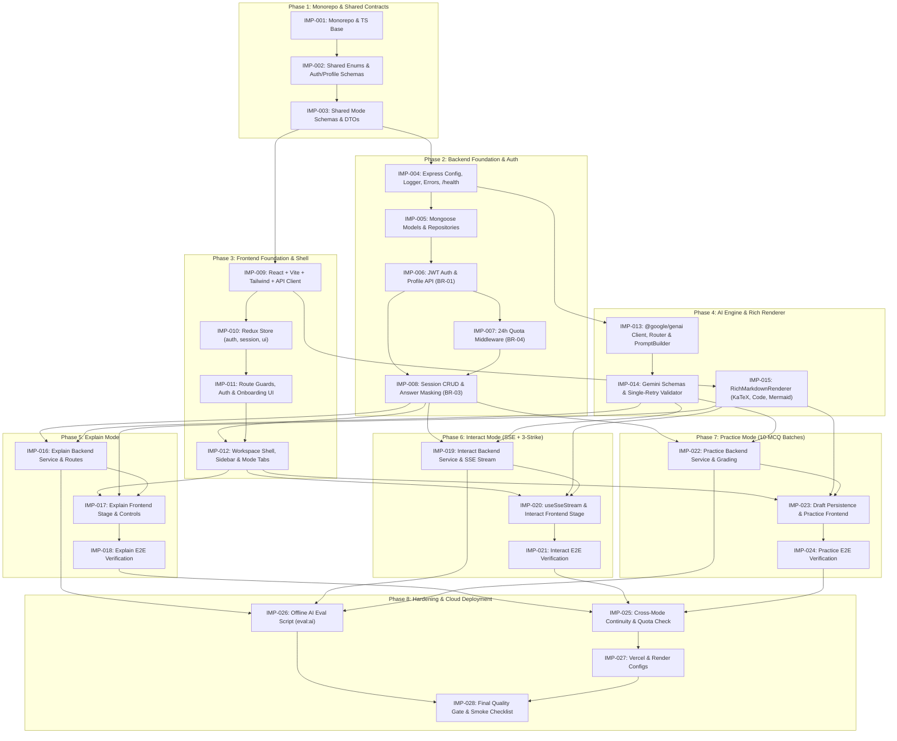

# Implementation Plan: Mentora

**Document Version:** 1.0.0 (MVP Baseline)  
**File Location:** Repository Root (`/implementation_plan.md`)  
**Source of Truth References:** `product_requirement.md` (`requirement.md`), `architecture.md`, `AGENTS.md`  
**Target Stack:** TypeScript Monorepo (`@mentora/shared`, `@mentora/server`, `@mentora/client`), React 18 + Vite + Tailwind + Redux Toolkit, Node.js 20 + Express + Mongoose (MongoDB Atlas), `@google/genai` (Google Gemini API)  
**Deployment Targets:** Vercel (Frontend SPA) + Render (Backend Web Service) + MongoDB Atlas  

---

## A. Plan Overview

### A.1 Purpose and Scope
This document translates Mentora's approved Product Requirements (`product_requirement.md`), System Architecture (`architecture.md`), and Project Coding Rules (`AGENTS.md`) into an ordered, dependency-aware sequence of granular engineering tasks (`IMP-001` through `IMP-028`). Each task is scoped so an AI coding agent or software engineer can implement, test, and verify it within a single focused coding session without reinterpreting the entire system.

### A.2 Current Repository State Assessment
Based on workspace inspection prior to implementation:
* **Existing Artifacts:** `product_requirement.md` (`requirement.md`), `architecture.md`, and `AGENTS.md` exist at the repository root.
* **Source Code State:** Application workspaces (`packages/shared`, `apps/server`, `apps/client`), `package.json`, and `tsconfig.base.json` have **not yet been initialized**. Therefore, Phase 1 begins from clean monorepo scaffolding.
* **Requirement ID Reconciliation Note:** Across earlier iterations of `product_requirement.md` and `architecture.md`, Practice Mode and Safety requirements are referenced as `FR-013`–`FR-017` in the PRD table and `FR-014`–`FR-018` in `architecture.md` (where `FR-013` specifically denotes the manual `"Explain this milestone directly"` escape control in Interact Mode). This plan preserves full traceability to **both** numbering references and all Business Rules (`BR-01`–`BR-04`), Acceptance Criteria (`AC-EXP-*`, `AC-INT-*`, `AC-PRC-*`), and Edge Cases (`Edge Case 1`–`5`).

### A.3 Intended MVP Outcome
Deliver a production-ready, cloud-deployed AI tutoring web application where authenticated learners:
1. Complete a mandatory 2-question **Static Learner Profile** (`Education Level` + `Preferred Explanation Style`) on first login (`BR-01`).
2. Enter any academic or skill-building topic to create a persistent `TopicSession` accessible from a collapsible Left History Sidebar (`FR-004`, `FR-006`).
3. Seamlessly switch across three learning modes bound to the active topic (`FR-005`):
   * **Explain Mode:** Progressive 4-card breakdown (*Intuition $\rightarrow$ Core Mechanism $\rightarrow$ Example $\rightarrow$ Check-for-Understanding*) with instant `Next` stepping, on-demand `Go Deeper` sub-cards, and native Markdown/KaTeX/Code/Mermaid.js rendering (`FR-007`–`FR-009`).
   * **Interact Mode:** Goal-oriented Socratic dialogue across 3–5 conceptual milestones streamed via Server-Sent Events (SSE), governed by a deterministic server-side **3-Strike Socratic Circuit Breaker** and manual escape hatch (`FR-010`–`FR-013`).
   * **Practice Mode:** Sequential 10-question MCQ batches across **Easy $\rightarrow$ Medium $\rightarrow$ Hard** tiers generated via a **Reasoning-First JSON Schema** (`solutionExplanation` before `correctOptionIndex`), with client-side draft persistence and deterministic $O(1)$ server-side grading (`FR-014`–`FR-017`, `BR-02`, `BR-03`).
4. Operate within a safe, cost-controlled boundary enforced by educational scope guardrails and a persistent **50 AI actions/day per-user quota** (`FR-016`/`FR-018`, `BR-04`).

### A.4 Summary of Implementation Phases
* **Phase 1: Monorepo Scaffolding & Shared Contracts (`IMP-001` – `IMP-003`)**
* **Phase 2: Backend Foundation, Database Models, Auth, & Quota Infrastructure (`IMP-004` – `IMP-008`)**
* **Phase 3: Frontend Foundation, Auth Flows, & Unified Workspace Shell (`IMP-009` – `IMP-012`)**
* **Phase 4: Shared AI Tutoring Engine & Rich Technical Content Renderer (`IMP-013` – `IMP-015`)**
* **Phase 5: Explain Mode End-to-End Implementation (`IMP-016` – `IMP-018`)**
* **Phase 6: Interact Mode & 3-Strike Socratic SSE Engine (`IMP-019` – `IMP-021`)**
* **Phase 7: Practice Mode & Tiered 10-MCQ Assessment Engine (`IMP-022` – `IMP-024`)**
* **Phase 8: Cross-Mode Hardening, E2E Integration, & Cloud Deployment (`IMP-025` – `IMP-028`)**

### A.5 Progress Tracking Protocol Across AI Sessions
* Every task in **Section D** maintains an explicit `Status` field (`Not Started`, `In Progress`, `Blocked`, `Done`).
* After completing and verifying a task according to **Section J (Definition of Done)**, the coding agent **MUST** update the task's `Status` in `implementation_plan.md` to `Done` and record the verification summary before ending the session.

---

## B. Implementation Principles

1. **Strict Document Hierarchy (`AGENTS.md` Section A):** Always consult `product_requirement.md`, `architecture.md`, and `AGENTS.md` before writing code. Never invent alternative folder structures, state managers, or database collections.
2. **Contract-First Development:** All domain enums, Zod validation schemas, and inferred TypeScript DTOs **MUST** be defined in `@mentora/shared` (`IMP-002`, `IMP-003`) before implementing backend controllers/services or frontend Redux slices/components.
3. **Foundations Before Features:** Build and test environment validation, Mongoose models, JWT auth, profile onboarding guards, and the shared `@google/genai` wrapper before implementing Explain, Interact, or Practice mode logic.
4. **Small, Cohesive, Independently Verifiable Tasks:** Execute one `IMP-*` task at a time. Do not combine backend AI service creation with frontend UI construction in a single unverified leap.
5. **Deterministic Testing Along the Way:** Every service, middleware, and UI state machine task includes mandatory unit or integration tests using `Vitest`, `Supertest`, `mongodb-memory-server`, or `React Testing Library`. Standard test suites **MUST** mock `@google/genai` so tests pass offline deterministically.
6. **Zero Unverified Completion Claims:** An agent **MUST NEVER** mark a task `Done` merely because files were written. Type checking (`pnpm typecheck`), linting (`pnpm lint`), and relevant tests (`pnpm test`) must be executed and reported.
7. **Blocker Escalation Rule:** If an agent encounters a missing environment credential required for live verification, an incompatible package peer dependency, or a specification conflict, it **MUST** stop, document the issue, and mark the task `Blocked` rather than weakening TypeScript strictness or bypassing security middlewares.

---

## C. Phase-by-Phase Roadmap

### Phase 1: Monorepo Scaffolding & Shared Contracts
* **Objective:** Initialize the `pnpm` workspace monorepo, strict TypeScript configuration, test runners, and the complete `@mentora/shared` contract package.
* **Prerequisites:** Approved `product_requirement.md`, `architecture.md`, and `AGENTS.md`.
* **Tasks:** `IMP-001`, `IMP-002`, `IMP-003`.
* **Deliverables:** Root workspace configuration, `packages/shared` enums, constants, Zod schemas (Auth, Profile, Session, Explain, Interact, Practice), inferred DTOs, and unit tests for all shared schemas.
* **Verification:** `pnpm --filter @mentora/shared build`, `pnpm --filter @mentora/shared typecheck`, and `pnpm --filter @mentora/shared test`.
* **Exit Criteria:** `@mentora/shared` compiles cleanly with zero `any` types and 100% of schema validation unit tests pass.

### Phase 2: Backend Foundation, Database Models, Auth, & Quota Infrastructure
* **Objective:** Build the stateless Express.js + TypeScript backend core, Mongoose models (`User`, `TopicSession`), repository layer, JWT auth, Static Learner Profile API, and rolling 24-hour quota middleware.
* **Prerequisites:** Phase 1 complete.
* **Tasks:** `IMP-004`, `IMP-005`, `IMP-006`, `IMP-007`, `IMP-008`.
* **Deliverables:** `apps/server` bootstrap, `/api/v1/health`, `User` and `TopicSession` models + repositories, `/api/v1/auth/*`, `/api/v1/profile`, `quota.middleware.ts`, and `/api/v1/sessions` CRUD endpoints.
* **Verification:** `Vitest` + `Supertest` + `mongodb-memory-server` integration suite covering auth, `BR-01` profile guard, `BR-04` quota enforcement, and `NFR-005` cross-user session isolation.
* **Exit Criteria:** All backend foundation and session CRUD integration tests pass with zero TypeScript errors.

### Phase 3: Frontend Foundation, Auth Flows, & Unified Workspace Shell
* **Objective:** Scaffold the React 18 + Vite + Tailwind + Redux Toolkit client, route guards (`ProtectedRoute`, `OnboardingGuard`), Auth/Onboarding pages, and the Unified Single-Page Workspace shell.
* **Prerequisites:** Phase 1 complete (can run in parallel with Phase 2 once `IMP-003` is complete; integrates with Phase 2 in `IMP-012`).
* **Tasks:** `IMP-009`, `IMP-010`, `IMP-011`, `IMP-012`.
* **Deliverables:** `apps/client` scaffold, Redux store (`authSlice`, `sessionSlice`, `uiSlice`), Axios client with Bearer JWT interceptor, Login/Register/Onboarding views, Left History Sidebar, Sticky Topic Header, Mode Switcher Tabs, and Quota Badge.
* **Verification:** Frontend component/router tests (`Vitest` + `React Testing Library`) and full build check (`pnpm --filter @mentora/client build`).
* **Exit Criteria:** Users can register, complete the mandatory 2-step profile onboarding, create/select/delete sessions in the Left Sidebar, and toggle between mode tabs.

### Phase 4: Shared AI Tutoring Engine & Rich Technical Content Renderer
* **Objective:** Implement the isolated `@google/genai` orchestration layer on the backend (`PromptBuilder`, `ModelRouter`, retry/validation runner) and the unified `<RichMarkdownRenderer />` on the frontend.
* **Prerequisites:** Phases 1–3 complete.
* **Tasks:** `IMP-013`, `IMP-014`, `IMP-015`.
* **Deliverables:** `apps/server/src/ai/` (`gemini.client.ts`, `model.router.ts`, `prompts/`, `schemas/`) and `apps/client/src/components/common/` (`RichMarkdownRenderer`, `KaTeXBlock`, `CodeBlock`, fault-tolerant `MermaidDiagram`).
* **Verification:** Unit tests for prompt calibration, schema validation retry logic, and `<MermaidDiagram />` fallback on malformed syntax (`Edge Case 3`).
* **Exit Criteria:** Backend AI wrapper validates structured outputs deterministically and frontend renders Markdown, $\LaTeX$, code, and Mermaid diagrams without crashing on invalid syntax.

### Phase 5: Explain Mode End-to-End Implementation
* **Objective:** Deliver Explain Mode across backend and frontend: 4-card structured generation, progressive `Next` stepping, and nested `Go Deeper` sub-cards.
* **Prerequisites:** Phase 4 complete.
* **Tasks:** `IMP-016`, `IMP-017`, `IMP-018`.
* **Deliverables:** `explain.service.ts`, `/explain/init`, `/explain/step`, `/explain/deeper` endpoints, and `ExplainStage.tsx` UI components.
* **Verification:** Backend service/API tests and frontend progressive card navigation tests verifying `AC-EXP-01`, `AC-EXP-02`, and `AC-EXP-03`.
* **Exit Criteria:** All Explain Mode acceptance criteria pass end-to-end.

### Phase 6: Interact Mode & 3-Strike Socratic SSE Engine
* **Objective:** Deliver Interact Mode across backend and frontend: 3–5 diagnostic milestone generation, real-time SSE token streaming, the deterministic **3-Strike Socratic Circuit Breaker**, and manual escape hatch.
* **Prerequisites:** Phase 4 complete.
* **Tasks:** `IMP-019`, `IMP-020`, `IMP-021`.
* **Deliverables:** `interact.service.ts`, `/interact/init`, `/interact/stream` (with `<<MENTORA_STATE:...>>` header stripping and 15s keep-alive), `useSseStream.ts`, and `InteractStage.tsx` UI.
* **Verification:** Unit tests for the 3-Strike state machine (`0 -> 1 -> 2 -> Circuit Breaker -> 0`), SSE stream integration tests, and mid-stream retry UI tests (`Edge Case 4`).
* **Exit Criteria:** Satisfies `AC-INT-01`, `AC-INT-02`, `AC-INT-03`, and `NFR-001`.

### Phase 7: Practice Mode & Tiered 10-MCQ Assessment Engine
* **Objective:** Deliver Practice Mode across backend and frontend: Reasoning-First 10-MCQ batch generation, answer-key masking while `in_progress`, `localStorage` mid-quiz draft persistence, deterministic $O(1)$ grading, and sequential `Easy -> Medium -> Hard` unlocking.
* **Prerequisites:** Phase 4 complete.
* **Tasks:** `IMP-022`, `IMP-023`, `IMP-024`.
* **Deliverables:** `practice.service.ts`, `/practice/generate`, `/practice/submit`, `useQuizDraftPersistence.ts`, and `PracticeStage.tsx` UI (Assessment view, Batch Review comparison view, 30-question Summary card).
* **Verification:** Unit/integration tests for Reasoning-First schema ordering (`FR-017`), answer masking (`BR-03`), tier lock enforcement (`BR-02`), and `localStorage` reload persistence (`Edge Case 5`).
* **Exit Criteria:** Satisfies `AC-PRC-01`, `AC-PRC-02`, `AC-PRC-03`, and `NFR-003`.

### Phase 8: Cross-Mode Hardening, E2E Integration, & Cloud Deployment
* **Objective:** Verify seamless cross-mode session continuity, build the standalone live AI evaluation script (`eval:ai`), configure production builds for Vercel and Render, and execute production smoke tests.
* **Prerequisites:** Phases 1–7 complete.
* **Tasks:** `IMP-025`, `IMP-026`, `IMP-027`, `IMP-028`.
* **Deliverables:** Cross-mode integration tests, `eval:ai` script, `vercel.json`, `render.yaml` / deployment configs, `.env.example` documentation, and production smoke verification checklist.
* **Verification:** Full monorepo `pnpm build`, `pnpm typecheck`, `pnpm lint`, `pnpm test`, and deployment verification.
* **Exit Criteria:** All MVP functional and non-functional requirements verified and ready for production release.

---

## D. Granular Implementation Tasks

### Phase 1 Tasks: Monorepo Scaffolding & Shared Contracts

#### `IMP-001` — Initialize Monorepo Workspace, TypeScript Base Config, and Quality Tooling
| Field | Specification |
| :--- | :--- |
| **Task ID** | `IMP-001` |
| **Task Name** | Initialize Monorepo Workspace, TypeScript Base Config, and Quality Tooling |
| **Objective** | Establish the root `pnpm` (or `npm`) workspace structure (`packages/shared`, `apps/server`, `apps/client`), strict `tsconfig.base.json`, ESLint/Prettier config, and Vitest workspace runner. |
| **Requirements** | `architecture.md` Sections B.1–B.2, M.1; `AGENTS.md` Sections B, C |
| **Dependencies** | None |
| **Scope** | Create root `package.json`, `pnpm-workspace.yaml`, `tsconfig.base.json` (`"strict": true`, `"noImplicitAny": true`, `"strictNullChecks": true`, `"noUncheckedIndexedAccess": true`), `.gitignore`, and minimal `package.json` + `tsconfig.json` files in `packages/shared`, `apps/server`, and `apps/client`. |
| **Deliverables** | Root monorepo configuration and workspace scripts (`build`, `typecheck`, `lint`, `test`). |
| **Acceptance Criteria** | 1. Running `pnpm install` links `@mentora/shared`, `@mentora/server`, and `@mentora/client`. 2. `tsconfig.base.json` enforces all mandatory strict flags from `AGENTS.md`. 3. `.gitignore` excludes `node_modules/`, `dist/`, `.env`, and coverage artifacts. |
| **Testing** | Execute `pnpm typecheck` and `pnpm test --passWithNoTests` across all workspaces. |
| **Priority** | Must Have |
| **Status** | Done |

#### `IMP-002` — Implement `@mentora/shared` Domain Enums, Constants, and Base Schemas
| Field | Specification |
| :--- | :--- |
| **Task ID** | `IMP-002` |
| **Task Name** | Implement `@mentora/shared` Domain Enums, Constants, and Base Schemas |
| **Objective** | Create the single source of truth for domain enumerations, business rule constants, and Auth/Profile Zod schemas. |
| **Requirements** | `FR-001`–`FR-003`, `FR-016`/`FR-018`, `BR-01`–`BR-04`; `architecture.md` Section B.2, G.1 |
| **Dependencies** | `IMP-001` |
| **Scope** | In `packages/shared/src/`: 1. `/enums`: `EducationLevel`, `ExplanationStyle`, `LearningMode`, `PracticeTier`, `BatchStatus`, `MilestoneStatus`, `ErrorCode`. 2. `/constants`: `DAILY_AI_QUOTA_LIMIT = 50`, `MAX_SOCRATIC_STRIKES = 3`, `MCQ_BATCH_SIZE = 10`, `MAX_TOPIC_QUERY_LENGTH = 300`, `MAX_INTERACT_MESSAGE_LENGTH = 2000`, `MAX_DEEP_DIVE_DEPTH = 2`. 3. `/schemas`: `auth.schema.ts` (register, login), `profile.schema.ts` (`StaticLearnerProfileSchema`), and standard API response/error envelope types. |
| **Deliverables** | Compiled `@mentora/shared` core enums, constants, and auth/profile schemas exported via `packages/shared/src/index.ts`. |
| **Acceptance Criteria** | 1. No magic literals exist; all enums and limits are exported as named constants/types. 2. `StaticLearnerProfileSchema` rejects missing or invalid `educationLevel` or `preferredStyle` values. 3. Topic and message length bounds match `NFR-004` / `AGENTS.md` Section J. |
| **Testing** | Unit tests in `packages/shared/src/__tests__/auth-profile.schema.test.ts` verifying valid and invalid payloads. |
| **Priority** | Must Have |
| **Status** | Done |

#### `IMP-003` — Implement `@mentora/shared` Mode Schemas (Explain, Interact, Practice) & DTOs
| Field | Specification |
| :--- | :--- |
| **Task ID** | `IMP-003` |
| **Task Name** | Implement `@mentora/shared` Mode Schemas (Explain, Interact, Practice) & DTOs |
| **Objective** | Define runtime Zod validation schemas and inferred TypeScript DTOs for `TopicSession`, Explain cards, Interact milestones/SSE frames, and Reasoning-First Practice MCQ batches. |
| **Requirements** | `FR-004`–`FR-017`; `architecture.md` Sections E.3–E.5, F.2, G.3; `AGENTS.md` Sections D, H |
| **Dependencies** | `IMP-002` |
| **Scope** | In `packages/shared/src/schemas/` and `/types/`: 1. `explain.schema.ts`: `ExplainCardSchema` (4 core step types), `DeepDiveSubCardSchema`, `ExplainInitOutputSchema` (including `isEducationalValid`, `refusalReason`, `suggestedSubTopics`). 2. `interact.schema.ts`: `InteractMilestoneSchema` (3–5 items), `InteractMessageSchema`, `InteractStreamRequestSchema`, `SseEventPayloads`. 3. `practice.schema.ts`: `McqQuestionFullSchema` (**enforcing `solutionExplanation` before `correctOptionIndex`**), `McqQuestionMaskedSchema` (omitting `correctOptionIndex` and `solutionExplanation` for `in_progress` batches per `BR-03`), `PracticeSubmitRequestSchema` (exact length 10). 4. `session.schema.ts`: `TopicSessionDTOSchema` and `SessionSummaryDTOSchema`. |
| **Deliverables** | Complete Zod schemas and `z.infer` DTOs in `@mentora/shared`. |
| **Acceptance Criteria** | 1. `PracticeBatchGenerationSchema` enforces exactly 10 questions, 4 options per question, `0 <= correctOptionIndex <= 3`, and `solutionExplanation` property order. 2. `McqQuestionMaskedSchema` strips answer keys. 3. `ExplainInitOutputSchema` enforces exactly 4 core cards when `isEducationalValid === true`. |
| **Testing** | Unit tests in `packages/shared/src/__tests__/modes.schema.test.ts` testing boundary conditions (e.g., 9 MCQs rejected, `correctOptionIndex: 4` rejected, masked schema strips keys). |
| **Priority** | Must Have |
| **Status** | Done |

---

### Phase 2 Tasks: Backend Foundation, Database Models, Auth, & Quota Infrastructure

#### `IMP-004` — Backend Server Bootstrap, Validated Config, Logger, & Error Handling
| Field | Specification |
| :--- | :--- |
| **Task ID** | `IMP-004` |
| **Task Name** | Backend Server Bootstrap, Validated Config, Logger, & Error Handling |
| **Objective** | Set up the Express + TypeScript application skeleton with fail-fast Zod environment validation, Pino structured logging, centralized `AppError` middleware, and `/api/v1/health`. |
| **Requirements** | `architecture.md` Sections D.1–D.2, G.2, M.2; `AGENTS.md` Sections E, J, M |
| **Dependencies** | `IMP-003` |
| **Scope** | In `apps/server/src/`: 1. `config/env.ts`: Validate `PORT`, `NODE_ENV`, `MONGODB_URI`, `JWT_SECRET`, `JWT_EXPIRES_IN`, `CLIENT_ORIGIN`, `GEMINI_API_KEY`, `GEMINI_FAST_MODEL`, `GEMINI_REASONING_MODEL`, `DAILY_AI_QUOTA_LIMIT`. 2. `config/logger.ts` (Pino with redacted secrets/headers) and `config/db.ts` (Mongoose connection lifecycle). 3. `utils/AppError.ts`, `utils/asyncHandler.ts`, `middlewares/validate.middleware.ts`, `middlewares/error.middleware.ts`. 4. `app.ts` (`helmet`, `cors` locked to `CLIENT_ORIGIN`, `express-rate-limit`, JSON body parser, `/api/v1/health` route) and `index.ts`. |
| **Deliverables** | Bootstrappable Express app with standardized error envelopes and health check endpoint. |
| **Acceptance Criteria** | 1. Missing required env vars throw a clear startup validation error. 2. `GET /api/v1/health` returns `200 OK` with `{ success: true, data: { status: 'ok', uptime } }`. 3. Thrown `AppError` instances return `{ success: false, error: { code, message, details? } }` with the proper HTTP status. |
| **Testing** | Unit/integration tests in `apps/server/src/__tests__/app.health-error.test.ts` verifying env validation, `/api/v1/health`, `400 VALIDATION_ERROR`, and `500` redaction. |
| **Priority** | Must Have |
| **Status** | Done |

#### `IMP-005` — Implement `User` and `TopicSession` Mongoose Models & Repositories
| Field | Specification |
| :--- | :--- |
| **Task ID** | `IMP-005` |
| **Task Name** | Implement `User` and `TopicSession` Mongoose Models & Repositories |
| **Objective** | Create the MongoDB persistence models, required indexes, and repository data-access classes enforcing multi-tenant user isolation (`NFR-005`). |
| **Requirements** | `architecture.md` Section F.1–F.2; `AGENTS.md` Section I (`NFR-005`, `BR-02`, `BR-03`) |
| **Dependencies** | `IMP-004` |
| **Scope** | In `apps/server/src/`: 1. `models/User.model.ts`: Schema with `name`, `email` (unique, lowercase), `passwordHash` (`select: false`), embedded `profile` (`isCompleted`, `educationLevel`, `preferredStyle`), and embedded `usageQuota` (`dailyCount`, `windowResetAt`). 2. `models/TopicSession.model.ts`: Schema with `userId`, `topicQuery`, `normalizedTitle`, `lastActiveMode`, `explainState`, `interactState`, `practiceState` (with initial batch states `easy: 'not_started'`, `medium: 'locked'`, `hard: 'locked'`), and compound indexes `{ userId: 1, updatedAt: -1 }` and `{ _id: 1, userId: 1 }`. 3. `repositories/user.repository.ts` and `repositories/session.repository.ts` (every session method requires both `sessionId` and `userId`). |
| **Deliverables** | Mongoose models and repository layer with strict ownership filtering. |
| **Acceptance Criteria** | 1. Querying a `User` by default excludes `passwordHash`. 2. Creating a `TopicSession` initializes `explainState`, `interactState`, and `practiceState` (`medium` and `hard` locked). 3. Attempting to read/update/delete a session with a mismatched `userId` returns `null` from `session.repository.ts`. |
| **Testing** | Repository integration tests using `mongodb-memory-server` in `apps/server/src/__tests__/repositories.test.ts`. |
| **Priority** | Must Have |
| **Status** | Done |

#### `IMP-006` — Implement JWT Authentication & Static Learner Profile Endpoints
| Field | Specification |
| :--- | :--- |
| **Task ID** | `IMP-006` |
| **Task Name** | Implement JWT Authentication & Static Learner Profile Endpoints |
| **Objective** | Deliver user registration, login, session verification, Static Learner Profile updates, and `authMiddleware` / `profileCompletedMiddleware`. |
| **Requirements** | `FR-001`–`FR-003`, `BR-01`, `NFR-005`; `architecture.md` Sections G.2, H.1 |
| **Dependencies** | `IMP-005` |
| **Scope** | In `apps/server/src/`: 1. `services/auth.service.ts`: `register` (`bcryptjs` cost factor 12), `login`, `getMe`, `updateProfile` (sets `profile.isCompleted = true`). 2. `middlewares/auth.middleware.ts`: `requireAuth` (verifies `Authorization: Bearer <jwt>` signed with `HS256`) and `requireCompletedProfile` (throws `403 PROFILE_INCOMPLETE` if `profile.isCompleted === false` per `BR-01`). 3. Controllers & Routes for `POST /api/v1/auth/register`, `POST /api/v1/auth/login`, `GET /api/v1/auth/me`, and `PUT /api/v1/profile`. |
| **Deliverables** | Working Auth and Profile REST endpoints and auth/profile guards. |
| **Acceptance Criteria** | 1. Newly registered users have `profile.isCompleted === false`. 2. Protected routes guarded by `requireCompletedProfile` return `403 PROFILE_INCOMPLETE` until `PUT /api/v1/profile` succeeds. 3. Invalid or expired JWTs return `401 UNAUTHORIZED`. |
| **Testing** | Supertest API integration tests in `apps/server/src/__tests__/auth-profile.routes.test.ts`. |
| **Priority** | Must Have |
| **Status** | Done |

#### `IMP-007` — Implement Rolling 24-Hour AI Usage Quota Middleware (`BR-04`)
| Field | Specification |
| :--- | :--- |
| **Task ID** | `IMP-007` |
| **Task Name** | Implement Rolling 24-Hour AI Usage Quota Middleware (`BR-04`) |
| **Objective** | Enforce the persistent 50 AI actions/day per-user limit on AI generation endpoints while keeping read-only and submission endpoints unrestricted. |
| **Requirements** | `FR-016`/`FR-018`, `BR-04`; `architecture.md` Section D.3; `AGENTS.md` Sections E, F |
| **Dependencies** | `IMP-006` |
| **Scope** | In `apps/server/src/middlewares/quota.middleware.ts` and `user.repository.ts`: 1. Check if `now >= user.usageQuota.windowResetAt`; if expired, atomically reset `dailyCount = 0` and set `windowResetAt = now + 24h`. 2. If `dailyCount >= env.DAILY_AI_QUOTA_LIMIT` (`50`), throw `429 DAILY_QUOTA_EXCEEDED` with `{ resetAt: windowResetAt }`. 3. Provide helper `incrementUserQuota(userId)` to increment `dailyCount` after successful AI generation and attach updated `meta.quota` to responses. |
| **Deliverables** | `quota.middleware.ts` and atomic quota update methods in `user.repository.ts`. |
| **Acceptance Criteria** | 1. Requests 1 through 50 within a 24h window pass. 2. Request 51 returns `429 DAILY_QUOTA_EXCEEDED` with `details.resetAt`. 3. Passing the `windowResetAt` timestamp automatically resets `dailyCount` to `0`. |
| **Testing** | Unit and integration tests in `apps/server/src/__tests__/quota.middleware.test.ts` testing boundary #50, #51, and 24-hour window rollover. |
| **Priority** | Must Have |
| **Status** | Done |

#### `IMP-008` — Implement `TopicSession` CRUD & Answer-Masking Mapper (`BR-03`)
| Field | Specification |
| :--- | :--- |
| **Task ID** | `IMP-008` |
| **Task Name** | Implement `TopicSession` CRUD & Answer-Masking Mapper (`BR-03`) |
| **Objective** | Implement session listing, retrieval, mode-tab switching, deletion, and a DTO sanitizer that masks unsubmitted Practice answer keys (`BR-03`). |
| **Requirements** | `FR-004`–`FR-006`, `BR-03`, `NFR-005`; `architecture.md` Section G.2 |
| **Dependencies** | `IMP-006`, `IMP-007` |
| **Scope** | In `apps/server/src/services/session.service.ts`, `controllers/session.controller.ts`, and `routes/session.routes.ts`: 1. `toTopicSessionDTO(doc)`: Maps Mongoose document to `TopicSessionDTO` and strips `correctOptionIndex` and `solutionExplanation` from any `PracticeBatch` where `status !== 'completed'`. 2. `GET /api/v1/sessions`: Returns chronological list of `SessionSummaryDTO` items. 3. `GET /api/v1/sessions/:id`: Returns full sanitized `TopicSessionDTO` (404 if not owned by user). 4. `PATCH /api/v1/sessions/:id/mode`: Updates `lastActiveMode`. 5. `DELETE /api/v1/sessions/:id`: Deletes session. 6. Base `POST /api/v1/sessions` shell (wired to mode engines in Phases 5–7). |
| **Deliverables** | Session management endpoints and DTO answer-key sanitizer. |
| **Acceptance Criteria** | 1. `GET /api/v1/sessions` returns sessions sorted by `updatedAt DESC`. 2. `User B` requesting or deleting `User A`'s session receives `404 RESOURCE_NOT_FOUND`. 3. Any Practice batch with `status === 'in_progress'` has `correctOptionIndex` and `solutionExplanation` omitted in the returned JSON. |
| **Testing** | Integration tests in `apps/server/src/__tests__/session.routes.test.ts`. |
| **Priority** | Must Have |
| **Status** | Done |

---

### Phase 3 Tasks: Frontend Foundation, Auth Flows, & Unified Workspace Shell

#### `IMP-009` — Scaffold `@mentora/client` (React + Vite + Tailwind) & API Client
| Field | Specification |
| :--- | :--- |
| **Task ID** | `IMP-009` |
| **Task Name** | Scaffold `@mentora/client` (React + Vite + Tailwind) & API Client |
| **Objective** | Initialize the React 18 + Vite + Tailwind CSS frontend, validate client env variables (`VITE_API_BASE_URL`), and build the centralized Axios client with JWT Bearer interceptors and cold-start health wake-up. |
| **Requirements** | `architecture.md` Sections B.2, C.1–C.2, H.1–H.2, M.2; `AGENTS.md` Sections G, J, M |
| **Dependencies** | `IMP-003` |
| **Scope** | In `apps/client/`: 1. Configure `vite.config.ts`, Tailwind CSS, PostCSS, and `src/config/env.ts` (Zod validation for `VITE_API_BASE_URL`). 2. Implement `src/services/apiClient.ts` (Axios instance attaching `Authorization: Bearer <token>`, normalizing `AppError` envelopes, and exposing `pingHealthCheck()` to wake sleeping Render instances on app mount). 3. Add top-level `<ErrorBoundary />` in `src/components/common/ErrorBoundary.tsx`. |
| **Deliverables** | Configured Vite + React + Tailwind workspace and typed API client layer. |
| **Acceptance Criteria** | 1. Client build fails fast if `VITE_API_BASE_URL` is invalid. 2. `apiClient` automatically injects the stored JWT token on outgoing requests. 3. `pingHealthCheck()` executes non-blockingly without crashing the UI if the backend is waking up. |
| **Testing** | Unit tests in `apps/client/src/__tests__/apiClient.test.ts` verifying header injection and error normalization. |
| **Priority** | Must Have |
| **Status** | Done |

#### `IMP-010` — Implement Redux Toolkit Store (`authSlice`, `sessionSlice`, `uiSlice`)
| Field | Specification |
| :--- | :--- |
| **Task ID** | `IMP-010` |
| **Task Name** | Implement Redux Toolkit Store (`authSlice`, `sessionSlice`, `uiSlice`) |
| **Objective** | Set up predictable state management for authentication, quota tracking, active `TopicSession` state across all 3 modes, SSE streaming buffers, and UI layout state. |
| **Requirements** | `FR-001`–`FR-006`; `architecture.md` Section C.2; `AGENTS.md` Section G |
| **Dependencies** | `IMP-009` |
| **Scope** | In `apps/client/src/store/`: 1. `authSlice.ts`: Manages `user`, `token` (synced with `localStorage`), `quota` (`used`, `limit`, `resetAt`), and async thunks (`loginThunk`, `registerThunk`, `fetchMeThunk`, `updateProfileThunk`). 2. `sessionSlice.ts`: Manages `sessionList`, `activeSession` (`TopicSessionDTO | null`), `activeMode` (`explain` \| `interact` \| `practice`), and `streamingState` (`isStreaming`, `streamBuffer`, `streamError`). 3. `uiSlice.ts`: Manages mobile/desktop sidebar open state, Profile Settings modal state, and notifications. 4. Typed hooks `useAppDispatch` and `useAppSelector`. |
| **Deliverables** | Complete Redux store and typed state hooks. |
| **Acceptance Criteria** | 1. Switching `activeMode` preserves `activeSession` in memory without clearing mode states. 2. Updating `meta.quota` from any API response updates the quota state in `authSlice`. 3. Logging out clears `token`, `user`, and `activeSession`. |
| **Testing** | Unit tests in `apps/client/src/__tests__/store.slices.test.ts` testing reducer transitions. |
| **Priority** | Must Have |
| **Status** | Done |

#### `IMP-011` — Implement Route Guards, Login/Register Pages, & Mandatory Onboarding Flow
| Field | Specification |
| :--- | :--- |
| **Task ID** | `IMP-011` |
| **Task Name** | Implement Route Guards, Login/Register Pages, & Mandatory Onboarding Flow |
| **Objective** | Build React Router v6 navigation with `ProtectedRoute` and `OnboardingGuard` (`BR-01`), Login/Register screens, the 2-step Static Learner Profile Onboarding screen, and the Profile Settings modal. |
| **Requirements** | `FR-001`–`FR-003`, `BR-01`, `NFR-004`; `architecture.md` Section C.1 |
| **Dependencies** | `IMP-010` |
| **Scope** | In `apps/client/src/`: 1. `routes/AppRouter.tsx`, `ProtectedRoute.tsx`, `OnboardingGuard.tsx`, `PublicOnlyGuard.tsx`. 2. `pages/LoginPage.tsx` and `pages/RegisterPage.tsx` with Zod client-side form validation. 3. `pages/OnboardingPage.tsx`: Interactive 2-step selector for `EducationLevel` (`High School`, `Undergraduate`, `Professional`) and `ExplanationStyle` (`Visual`, `Analogy-Heavy`, `Concise & Technical`). 4. `components/layout/ProfileSettingsModal.tsx` allowing profile updates at any time (`FR-003`). |
| **Deliverables** | Auth pages, Onboarding page, Profile Settings modal, and route protection guards. |
| **Acceptance Criteria** | 1. Unauthenticated users visiting `/workspace` are redirected to `/login`. 2. Authenticated users with `profile.isCompleted === false` visiting `/workspace` are redirected to `/onboarding` (`BR-01`). 3. Completing `/onboarding` updates the profile and navigates to `/workspace`. |
| **Testing** | Component and routing tests in `apps/client/src/__tests__/auth-onboarding.test.tsx`. |
| **Priority** | Must Have |
| **Status** | Done |

#### `IMP-012` — Implement Unified Workspace Shell, Left History Sidebar, & Mode Switcher Tabs
| Field | Specification |
| :--- | :--- |
| **Task ID** | `IMP-012` |
| **Task Name** | Implement Unified Workspace Shell, Left History Sidebar, & Mode Switcher Tabs |
| **Objective** | Build the responsive Single-Page Workspace layout including the Empty Topic Prompt view, Collapsible Left History Sidebar, Sticky Topic Header, Top Mode Switcher Tabs (`Explain` \| `Interact` \| `Practice`), and Daily Quota Badge. |
| **Requirements** | `FR-004`–`FR-006`, `FR-016`/`FR-018`, `NFR-004`; `architecture.md` Sections B.2, C.2 |
| **Dependencies** | `IMP-008`, `IMP-011` |
| **Scope** | In `apps/client/src/`: 1. `pages/WorkspacePage.tsx`: Renders either the New Topic input stage (with 300-char limit, mode selector cards, and educational refusal banner support) or the active `TopicSession` stage. 2. `components/layout/LeftHistorySidebar.tsx`: Lists saved sessions grouped chronologically, `+ New Topic` button, session delete confirmation, and bottom user/profile bar. 3. `components/layout/StickyTopicHeader.tsx` & `ModeSwitcherTabs.tsx`: Switches between `Explain`, `Interact`, and `Practice` tabs without re-entering the topic (`FR-005`) and syncs `PATCH /api/v1/sessions/:id/mode`. 4. `components/layout/QuotaBadge.tsx` & `hooks/useQuotaStatus.ts`: Displays remaining daily AI actions (`50 - used`) and reset time when exhausted (`BR-04`). |
| **Deliverables** | Complete Workspace shell and navigation components. |
| **Acceptance Criteria** | 1. Clicking a session in the Left Sidebar loads it into the workspace. 2. Toggling `Explain`, `Interact`, and `Practice` tabs switches the active stage while keeping the current session bound. 3. Layout is keyboard-accessible and responsive across mobile (`360px+`) and desktop (`1024px+`) viewports (`NFR-004`). |
| **Testing** | Component tests in `apps/client/src/__tests__/WorkspaceShell.test.tsx`. |
| **Priority** | Must Have |
| **Status** | Done |

---

### Phase 4 Tasks: Shared AI Tutoring Engine & Rich Technical Content Renderer

#### `IMP-013` — Implement Backend `@google/genai` Client, Dual-Model Router, & Prompt Builder
| Field | Specification |
| :--- | :--- |
| **Task ID** | `IMP-013` |
| **Task Name** | Implement Backend `@google/genai` Client, Dual-Model Router, & Prompt Builder |
| **Objective** | Build the isolated AI integration layer in `apps/server/src/ai/` encapsulating `@google/genai`, dual-model routing (`GEMINI_FAST_MODEL` vs. `GEMINI_REASONING_MODEL`), and the profile-calibrated `PromptBuilder`. |
| **Requirements** | `FR-002`, `FR-009`, `FR-016`/`FR-018`, `Edge Case 1`–`3`; `architecture.md` Sections E.1–E.2; `AGENTS.md` Section H |
| **Dependencies** | `IMP-004` |
| **Scope** | In `apps/server/src/ai/`: 1. `gemini.client.ts`: Initializes official `@google/genai` SDK (`GoogleGenAI`) using `env.GEMINI_API_KEY`. 2. `model.router.ts`: Maps operations (`EXPLAIN_INIT`, `EXPLAIN_DEEPER`, `INTERACT_INIT`, `INTERACT_STREAM`, `PRACTICE_GENERATE`) to `env.GEMINI_FAST_MODEL` or `env.GEMINI_REASONING_MODEL`. 3. `prompts/prompt.builder.ts`: Injects (a) Educational Scope & Safety Guardrails (`Edge Case 2`), (b) Static Learner Profile calibration (`educationLevel` $\times$ `preferredStyle` matrix from Section 9.1 of PRD), and (c) strict formatting rules (inline `$...$` and block `$$...$$` $\LaTeX$, fenced code blocks, and quoted Mermaid labels `A["Label"]`). |
| **Deliverables** | Isolated `@google/genai` wrapper, model router, and shared pedagogical prompt builder. |
| **Acceptance Criteria** | 1. No module outside `apps/server/src/ai/` imports `@google/genai`. 2. `PromptBuilder` outputs distinct pedagogical instructions for every combination of `EducationLevel` (`high_school`, `undergraduate`, `professional`) and `ExplanationStyle` (`visual`, `analogy_heavy`, `concise_technical`). 3. `ModelRouter` reads model names strictly from validated environment variables. |
| **Testing** | Unit tests in `apps/server/src/__tests__/ai.prompt-router.test.ts`. |
| **Priority** | Must Have |
| **Status** | Done |

#### `IMP-014` — Implement Gemini Structured Output Schemas, Validation Runner, & Single-Retry Guard
| Field | Specification |
| :--- | :--- |
| **Task ID** | `IMP-014` |
| **Task Name** | Implement Gemini Structured Output Schemas, Validation Runner, & Single-Retry Guard |
| **Objective** | Map `@mentora/shared` contracts to Gemini `responseSchema` declarations and implement a resilient execution helper that validates outputs with Zod, retries once on malformed output, and maps refusals/upstream failures to `AppError`. |
| **Requirements** | `FR-016`–`FR-018`, `NFR-003`, `Edge Case 2`; `architecture.md` Sections E.1–E.5; `AGENTS.md` Sections E, H |
| **Dependencies** | `IMP-013` |
| **Scope** | In `apps/server/src/ai/schemas/` and `gemini.client.ts`: 1. Define Gemini `responseSchema` objects for Explain Init (4 cards + `isEducationalValid`), Explain Go Deeper, Interact Init (3–5 milestones + opening prompt), and Practice 10-MCQ Batch (**with `solutionExplanation` strictly preceding `correctOptionIndex`**). 2. Implement `generateStructuredOutput<T>({ operation, systemInstruction, prompt, responseSchema, zodSchema })`: calls Gemini, parses JSON with `zodSchema`, automatically retries once if JSON/Zod validation fails, and throws `502 AI_UPSTREAM_FAILURE` on second failure or timeout. 3. If `isEducationalValid === false`, throw `422 EDUCATIONAL_GUARDRAIL_REFUSAL` with the refusal message. |
| **Deliverables** | Structured generation runner and Gemini schema declarations. |
| **Acceptance Criteria** | 1. First-attempt invalid JSON triggers exactly 1 automatic retry. 2. Second-attempt invalid JSON throws `502 AI_UPSTREAM_FAILURE`. 3. Non-educational prompt output (`isEducationalValid: false`) throws `422 EDUCATIONAL_GUARDRAIL_REFUSAL` without persisting a corrupt session. |
| **Testing** | Unit tests with mocked `@google/genai` responses in `apps/server/src/__tests__/ai.structured-runner.test.ts`. |
| **Priority** | Must Have |
| **Status** | Done |

#### `IMP-015` — Implement Frontend `<RichMarkdownRenderer />` (GFM, KaTeX, Code, Fault-Tolerant Mermaid)
| Field | Specification |
| :--- | :--- |
| **Task ID** | `IMP-015` |
| **Task Name** | Implement Frontend `<RichMarkdownRenderer />` (GFM, KaTeX, Code, Fault-Tolerant Mermaid) |
| **Objective** | Build the shared rich content rendering pipeline used across Explain cards, Interact chat bubbles, and Practice MCQ stems/rationales. |
| **Requirements** | `FR-009`, `NFR-004`, `Edge Case 3`; `architecture.md` Section C.3; `AGENTS.md` Sections E, G |
| **Dependencies** | `IMP-009` |
| **Scope** | In `apps/client/src/components/common/`: 1. `RichMarkdownRenderer.tsx`: Memoized component wrapping `react-markdown`, `remark-gfm`, `remark-math`, and `rehype-katex` (`katex/dist/katex.min.css`). 2. `CodeBlock.tsx`: Renders syntax-highlighted fenced code blocks (`react-syntax-highlighter` or `shiki`) with language header and 1-click Copy button. 3. `MermaidDiagram.tsx`: Intercepts `language-mermaid` code blocks, validates syntax via `mermaid.parse()` inside a `try/catch` block, renders responsive SVG on success, and falls back to a clean preformatted diagram/code container if syntax is invalid (`Edge Case 3`). |
| **Deliverables** | `<RichMarkdownRenderer />`, `<CodeBlock />`, and `<MermaidDiagram />` components. |
| **Acceptance Criteria** | 1. Inline `$E = mc^2$` and block `$$...$$` math expressions render via KaTeX. 2. Code blocks display syntax highlighting and copy-to-clipboard feedback. 3. Passing malformed Mermaid syntax to `<MermaidDiagram />` renders the fallback view without throwing an unhandled React error (`Edge Case 3`). |
| **Testing** | Component tests in `apps/client/src/__tests__/RichMarkdownRenderer.test.tsx` covering GFM tables, KaTeX, code copy, and malformed Mermaid fallback. |
| **Priority** | Must Have |
| **Status** | Done |

---

### Phase 5 Tasks: Explain Mode End-to-End Implementation

#### `IMP-016` — Implement Backend Explain Mode Service & REST Endpoints
| Field | Specification |
| :--- | :--- |
| **Task ID** | `IMP-016` |
| **Task Name** | Implement Backend Explain Mode Service & REST Endpoints |
| **Objective** | Implement `ExplainService` and endpoints for 4-card initialization, `currentStepIndex` progression, and `Go Deeper` sub-card generation. |
| **Requirements** | `FR-004`, `FR-007`, `FR-008`, `AC-EXP-01`–`AC-EXP-03`, `Edge Case 1`–`2`; `architecture.md` Sections E.3, G.2 |
| **Dependencies** | `IMP-008`, `IMP-014` |
| **Scope** | In `apps/server/src/`: 1. `services/explain.service.ts`:    • `initializeExplain(userId, sessionId)`: If `explainState.status === 'ready'`, return existing state; otherwise call `GEMINI_FAST_MODEL`, validate 4 cards (`Intuition`, `Core Mechanism`, `Example`, `Check-for-Understanding`), set `currentStepIndex = 0`, persist to `TopicSession`, and increment user quota.    • `advanceStep(userId, sessionId, stepIndex)`: Updates `currentStepIndex` (`0..3`) without consuming AI quota.    • `generateDeepDive(userId, sessionId, stepNumber)`: Calls `GEMINI_REASONING_MODEL` with parent card context, appends `DeepDiveSubCard` (up to depth 2) to `cards[stepNumber - 1].deepDives`, persists, and increments user quota. 2. Wire `POST /api/v1/sessions` (when `initialMode === 'explain'`), `POST /api/v1/sessions/:id/explain/init`, `PATCH /api/v1/sessions/:id/explain/step`, and `POST /api/v1/sessions/:id/explain/deeper`. |
| **Deliverables** | `explain.service.ts`, `explain.controller.ts`, and Explain API routes. |
| **Acceptance Criteria** | 1. Initializing Explain Mode creates 4 cards with `currentStepIndex === 0` (`AC-EXP-01`). 2. `PATCH /explain/step` updates `currentStepIndex` without incrementing `usageQuota.dailyCount`. 3. `POST /explain/deeper` appends a sub-card under the target card without resetting `currentStepIndex` (`AC-EXP-03`). |
| **Testing** | Unit and Supertest integration tests in `apps/server/src/__tests__/explain.service.test.ts`. |
| **Priority** | Must Have |
| **Status** | Done |

#### `IMP-017` — Implement Frontend Explain Mode Stage, Progressive Card Stepper, & `Go Deeper` UI
| Field | Specification |
| :--- | :--- |
| **Task ID** | `IMP-017` |
| **Task Name** | Implement Frontend Explain Mode Stage, Progressive Card Stepper, & `Go Deeper` UI |
| **Objective** | Build the Explain Mode UI displaying progressive cards up to `currentStepIndex`, `Next` and `Go Deeper` controls, Check-for-Understanding reveal toggle, and mode transition CTAs. |
| **Requirements** | `FR-007`–`FR-009`, `AC-EXP-01`–`AC-EXP-03`, `NFR-004`; `architecture.md` Sections B.2, E.3 |
| **Dependencies** | `IMP-012`, `IMP-015`, `IMP-016` |
| **Scope** | In `apps/client/src/components/explain/`: 1. `ExplainStage.tsx`: Auto-triggers `/explain/init` if `explainState.status === 'not_started'`, renders skeleton loader during initial generation. 2. `StepProgressBar.tsx`: Visual 4-step indicator (`1. Intuition` $\rightarrow$ `2. Core Mechanism` $\rightarrow$ `3. Example` $\rightarrow$ `4. Check-for-Understanding`). 3. `ExplainCard.tsx` & `DeepDiveSubCard.tsx`: Renders card content via `<RichMarkdownRenderer />`, collapsible Check-for-Understanding answer reveal on Card 4, and nested deep-dive sub-cards. 4. `CardControls.tsx`: Keyboard-accessible `Next` button, `Go Deeper` button (with loading spinner), suggested narrower sub-topic chips (`Edge Case 1`), and Card 4 CTAs (*"Discuss in Interact Mode"* / *"Test Yourself in Practice Mode"*). |
| **Deliverables** | Complete Explain Mode frontend components and Redux thunks. |
| **Acceptance Criteria** | 1. On initial load, only Card 1 is visible (`AC-EXP-01`). 2. Clicking `Next` reveals Card 2, 3, and 4 sequentially (`AC-EXP-02`). 3. Clicking `Go Deeper` renders the nested sub-card directly beneath the active card (`AC-EXP-03`). |
| **Testing** | Frontend component tests in `apps/client/src/__tests__/ExplainStage.test.tsx`. |
| **Priority** | Must Have |
| **Status** | Done |

#### `IMP-018` — Verify End-to-End Explain Mode Workflow & Acceptance Criteria
| Field | Specification |
| :--- | :--- |
| **Task ID** | `IMP-018` |
| **Task Name** | Verify End-to-End Explain Mode Workflow & Acceptance Criteria |
| **Objective** | Validate the complete Explain Mode flow from new topic submission through Card 4 completion and sub-card expansion. |
| **Requirements** | `AC-EXP-01`, `AC-EXP-02`, `AC-EXP-03`, `Edge Case 1`–`3` |
| **Dependencies** | `IMP-017` |
| **Scope** | Write integration tests verifying: (1) `POST /api/v1/sessions` with `initialMode: 'explain'`, (2) stepping `0 -> 1 -> 2 -> 3`, (3) `Go Deeper` persistence across session reload (`GET /api/v1/sessions/:id`), and (4) educational refusal banner display on invalid topics. |
| **Deliverables** | End-to-end Explain Mode test suite. |
| **Acceptance Criteria** | All Explain Mode acceptance criteria (`AC-EXP-01`–`03`) and edge cases pass automated tests. |
| **Testing** | Run `pnpm test` across `@mentora/server` and `@mentora/client`. |
| **Priority** | Must Have |
| **Status** | Done |

---

### Phase 6 Tasks: Interact Mode & 3-Strike Socratic SSE Engine

#### `IMP-019` — Implement Backend Interact Mode Service, 3-Strike State Machine, & Unbuffered SSE Controller
| Field | Specification |
| :--- | :--- |
| **Task ID** | `IMP-019` |
| **Task Name** | Implement Backend Interact Mode Service, 3-Strike State Machine, & Unbuffered SSE Controller |
| **Objective** | Implement milestone initialization (`/interact/init`) and the streaming Socratic turn engine (`/interact/stream`) with deterministic 3-Strike state transitions and Render-compatible SSE headers. |
| **Requirements** | `FR-010`–`FR-013`, `AC-INT-01`–`AC-INT-03`, `NFR-001`, `Edge Case 4`; `architecture.md` Sections E.4, G.3, H.2; `AGENTS.md` Sections H, M |
| **Dependencies** | `IMP-008`, `IMP-014` |
| **Scope** | In `apps/server/src/`: 1. `services/interact.service.ts`:    • `initializeInteract(userId, sessionId)`: Calls `GEMINI_FAST_MODEL` to generate 3–5 sequential milestones (`Milestone 1` set to `'active'`, others `'pending'`) and the opening diagnostic question; persists to `interactState` and increments quota.    • `processTurnStream(userId, sessionId, message, forceDirectExplanation, sseWriter)`: Builds Socratic prompt calibrated to current `strikeCount` (`0`, `1`, `2`) and `forceDirectExplanation`; streams from `GEMINI_FAST_MODEL`; buffers only the first line to parse and strip `<<MENTORA_STATE:{"outcome":"ADVANCE"|"STRIKE"|"CIRCUIT_BREAKER_ACK"}>>`; streams remaining markdown deltas via `event: token`; deterministically computes next `strikeCount` and `activeMilestoneIndex` (`0 -> 1 -> 2 -> Circuit Breaker reset to 0`); persists user + assistant messages to MongoDB; increments quota; emits `event: metadata` and `event: done`. 2. `utils/sse.helper.ts` & `controllers/interact.controller.ts`: Sets `Content-Type: text/event-stream`, `Cache-Control: no-cache, no-transform`, `Connection: keep-alive`, `X-Accel-Buffering: no`, and a 15-second `: keepalive\n\n` heartbeat timer. On mid-stream error, emits `event: error` without incrementing `strikeCount`. |
| **Deliverables** | `interact.service.ts`, `sse.helper.ts`, `interact.controller.ts`, and Interact routes. |
| **Acceptance Criteria** | 1. `/interact/init` generates 3–5 milestones and an opening diagnostic question (`AC-INT-01`). 2. Three consecutive `"STRIKE"` outcomes transition `strikeCount` `0 -> 1 (Nudge) -> 2 (Hint) -> Circuit Breaker explanation + reset to 0` (`AC-INT-02`). 3. `forceDirectExplanation: true` immediately triggers the Circuit Breaker explanation and resets `strikeCount = 0` (`FR-013`). 4. `<<MENTORA_STATE:...>>` never leaks into the client's visible message text. 5. Stream failure emits `event: error` and leaves `strikeCount` unchanged (`Edge Case 4`). |
| **Testing** | Unit tests in `apps/server/src/__tests__/interact.state-machine.test.ts` covering all strike/advance/manual-override/error transitions. |
| **Priority** | Must Have |
| **Status** | Not Started |

#### `IMP-020` — Implement Frontend SSE Client Hook (`useSseStream`) & Interact Mode UI Stage
| Field | Specification |
| :--- | :--- |
| **Task ID** | `IMP-020` |
| **Task Name** | Implement Frontend SSE Client Hook (`useSseStream`) & Interact Mode UI Stage |
| **Objective** | Build the `fetch` + `ReadableStream` SSE consumer hook and the Interact Mode UI with Milestone Progress Tracker, streaming chat transcript, manual `"Explain this milestone directly"` button, and mid-stream retry control. |
| **Requirements** | `FR-010`–`FR-013`, `AC-INT-01`–`AC-INT-03`, `Edge Case 4`, `NFR-001`, `NFR-004`; `architecture.md` Sections C.4, G.3 |
| **Dependencies** | `IMP-012`, `IMP-015`, `IMP-019` |
| **Scope** | In `apps/client/src/`: 1. `hooks/useSseStream.ts`: Sends `POST /api/v1/sessions/:id/interact/stream` with `Authorization: Bearer <token>`, parses `start`, `token`, `metadata`, `done`, and `error` SSE events, updates Redux `streamingState`, and supports abort/retry. 2. `components/interact/InteractStage.tsx`: Initializes `/interact/init` on first visit. 3. `MilestoneTrackerBar.tsx`: Displays the 3–5 milestones with completed checkmarks, active badge, and subtle strike hint indicator. 4. `ChatTranscript.tsx` & `StreamingBubble.tsx`: Renders historical and live-streaming messages using `<RichMarkdownRenderer />`, plus inline `"Connection interrupted — Retry"` button on stream drop (`Edge Case 4`). 5. `ChatInput.tsx`: Textarea (2,000-char cap) + `"Explain this milestone directly"` escape hatch button (`FR-013`). |
| **Deliverables** | `useSseStream.ts` and all `components/interact/*` modules. |
| **Acceptance Criteria** | 1. Milestone progress bar updates immediately when `event: metadata` marks a milestone completed (`AC-INT-03`). 2. Streaming tokens render smoothly inside `<StreamingBubble />`. 3. Clicking `"Explain this milestone directly"` sends `forceDirectExplanation: true`. 4. Simulated network drop reveals the retry button and re-sends the last turn cleanly (`Edge Case 4`). |
| **Testing** | Hook and component tests in `apps/client/src/__tests__/InteractStage.test.tsx`. |
| **Priority** | Must Have |
| **Status** | Not Started |

#### `IMP-021` — Verify End-to-End Interact Mode & 3-Strike Circuit Breaker
| Field | Specification |
| :--- | :--- |
| **Task ID** | `IMP-021` |
| **Task Name** | Verify End-to-End Interact Mode & 3-Strike Circuit Breaker |
| **Objective** | Verify full integration between the Express SSE stream endpoint, MongoDB session persistence, and React streaming UI. |
| **Requirements** | `AC-INT-01`, `AC-INT-02`, `AC-INT-03`, `Edge Case 4` |
| **Dependencies** | `IMP-020` |
| **Scope** | Execute Supertest SSE stream integration tests verifying header flushing, control header stripping, milestone completion advancement, and 3-Strike reset persistence in MongoDB. |
| **Deliverables** | End-to-end SSE integration test suite. |
| **Acceptance Criteria** | All Interact Mode acceptance criteria (`AC-INT-01`–`03`) pass automated tests. |
| **Testing** | Run `pnpm test` across `@mentora/server` and `@mentora/client`. |
| **Priority** | Must Have |
| **Status** | Not Started |

---

### Phase 7 Tasks: Practice Mode & Tiered 10-MCQ Assessment Engine

#### `IMP-022` — Implement Backend Practice Mode Service (Reasoning-First Generation, Masking, & $O(1)$ Grading)
| Field | Specification |
| :--- | :--- |
| **Task ID** | `IMP-022` |
| **Task Name** | Implement Backend Practice Mode Service (Reasoning-First Generation, Masking, & $O(1)$ Grading) |
| **Objective** | Implement 10-MCQ batch generation using `GEMINI_REASONING_MODEL` with the Reasoning-First schema (`FR-017`), sequential tier lock validation (`BR-02`), answer-key masking (`BR-03`), and deterministic batch grading (`/practice/submit`). |
| **Requirements** | `FR-014`–`FR-017` (`FR-013`–`FR-015` in PRD table), `BR-02`, `BR-03`, `AC-PRC-01`–`AC-PRC-03`, `NFR-002`, `NFR-003`; `architecture.md` Sections E.5, G.2; `AGENTS.md` Sections H, I |
| **Dependencies** | `IMP-008`, `IMP-014` |
| **Scope** | In `apps/server/src/`: 1. `services/practice.service.ts`:    • `generateBatch(userId, sessionId, tier)`: Verifies `tier` is not `'locked'` (throws `409 TIER_LOCKED` if locked per `BR-02`); if batch is already `'in_progress'` or `'completed'`, returns sanitized batch without re-billing quota; otherwise invokes `GEMINI_REASONING_MODEL` with Reasoning-First schema (`solutionExplanation` before `correctOptionIndex`), saves 10 questions with `status = 'in_progress'`, increments quota, and returns masked DTO (`correctOptionIndex` and `solutionExplanation` stripped per `BR-03`).    • `submitBatch(userId, sessionId, tier, answers)`: Validates `answers.length === 10` (`0..3`), grades deterministically in $O(1)$ by comparing `answers[i] === questions[i].correctOptionIndex` (never calling an LLM to grade), sets `status = 'completed'`, records `score` ($0\text{–}10$) and `completedAt`, unlocks the next tier (`easy -> medium`, `medium -> hard` from `'locked'` to `'not_started'`), and returns the full unmasked batch with `solutionExplanation` and `correctOptionIndex`. 2. Wire `POST /api/v1/sessions/:id/practice/generate` and `POST /api/v1/sessions/:id/practice/submit`. Note: `/practice/submit` does **not** use `quotaMiddleware` (`BR-04`). |
| **Deliverables** | `practice.service.ts`, `practice.controller.ts`, and Practice API routes. |
| **Acceptance Criteria** | 1. Generating `medium` or `hard` before completing the prior tier returns `409 TIER_LOCKED` (`BR-02`, `AC-PRC-01`). 2. Unsubmitted batch responses omit `correctOptionIndex` and `solutionExplanation` (`BR-03`). 3. Submitting fewer than 10 answers returns `400 VALIDATION_ERROR` (`BR-03`). 4. Submitting 10 answers calculates the exact score deterministically, reveals full rationales, and unlocks the next tier (`AC-PRC-02`, `AC-PRC-03`). |
| **Testing** | Unit and integration tests in `apps/server/src/__tests__/practice.service.test.ts`. |
| **Priority** | Must Have |
| **Status** | Not Started |

#### `IMP-023` — Implement Frontend `useQuizDraftPersistence` Hook & Practice Mode UI Stage
| Field | Specification |
| :--- | :--- |
| **Task ID** | `IMP-023` |
| **Task Name** | Implement Frontend `useQuizDraftPersistence` Hook & Practice Mode UI Stage |
| **Objective** | Build the Practice Mode UI including the Tier Selector bar (`Easy` \| `Medium` \| `Hard` with lock indicators), 10-MCQ assessment cards with on-demand hints, `localStorage` mid-quiz draft persistence (`Edge Case 5`), Batch Review screen, and 30-question Practice Summary. |
| **Requirements** | `FR-014`–`FR-016`, `BR-02`, `BR-03`, `AC-PRC-01`–`AC-PRC-03`, `Edge Case 5`, `NFR-002`, `NFR-004`; `architecture.md` Sections C.2, E.5, M.3 |
| **Dependencies** | `IMP-012`, `IMP-015`, `IMP-022` |
| **Scope** | In `apps/client/src/`: 1. `hooks/useQuizDraftPersistence.ts`: Persists selected answers for an `in_progress` batch to `localStorage` (`mentora_quiz_draft_${sessionId}_${tier}`), validates restored drafts with Zod, and clears the key upon batch submission (`Edge Case 5`). 2. `components/practice/PracticeStage.tsx`: Manages tier selection, 6–12s progressive generation skeleton state (`NFR-002`, `45,000ms` request timeout per `architecture.md` Section M.3), and active view switching. 3. `TierSelectorBar.tsx`: Displays `Easy`, `Medium`, and `Hard` tabs with lock icons and scores ($X/10$). 4. `McqQuestionCard.tsx`: Accessible radio option groups (`A`, `B`, `C`, `D`) rendered with `<RichMarkdownRenderer />` and collapsible `"Show Hint"` toggle. 5. `BatchReviewView.tsx`: Displays batch score banner, highlights **Your Choice** (Red if wrong / Green if right) alongside **Correct Option** (Green) and step-by-step `solutionExplanation` for all 10 questions, plus primary CTA `"Start Medium Batch (10 Questions)"` / `"Start Hard Batch (10 Questions)"`. 6. `PracticeSummary.tsx`: Shown when all 3 tiers (`30 questions`) are completed, displaying Easy ($X/10$), Medium ($Y/10$), Hard ($Z/10$), and Total Score ($(X+Y+Z)/30$). |
| **Deliverables** | `useQuizDraftPersistence.ts` and all `components/practice/*` modules. |
| **Acceptance Criteria** | 1. Selecting MCQ options immediately writes to `localStorage` and survives a simulated page reload or mode tab switch (`Edge Case 5`). 2. `"Submit Batch"` button remains disabled until all 10 questions have a selected option (`BR-03`). 3. Batch Review view clearly labels both the user's choice and the verified correct option with rendered $\LaTeX$/code rationales (`AC-PRC-02`). |
| **Testing** | Hook and component tests in `apps/client/src/__tests__/PracticeStage.test.tsx`. |
| **Priority** | Must Have |
| **Status** | Not Started |

#### `IMP-024` — Verify End-to-End Practice Mode Progression (`Easy -> Medium -> Hard`)
| Field | Specification |
| :--- | :--- |
| **Task ID** | `IMP-024` |
| **Task Name** | Verify End-to-End Practice Mode Progression (`Easy -> Medium -> Hard`) |
| **Objective** | Validate the complete 30-question tiered retrieval workflow across backend and frontend. |
| **Requirements** | `AC-PRC-01`, `AC-PRC-02`, `AC-PRC-03`, `BR-02`, `BR-03`, `Edge Case 5` |
| **Dependencies** | `IMP-023` |
| **Scope** | Run automated integration tests covering: initial Easy generation (`medium`/`hard` locked) $\rightarrow$ masked payload check $\rightarrow$ Easy submission $\rightarrow$ Medium unlock & generation $\rightarrow$ Medium submission $\rightarrow$ Hard unlock & generation $\rightarrow$ Hard submission & 30-question summary state. |
| **Deliverables** | End-to-end Practice Mode progression test suite. |
| **Acceptance Criteria** | All Practice Mode acceptance criteria (`AC-PRC-01`–`03`) and business rules (`BR-02`, `BR-03`) pass automated verification. |
| **Testing** | Run `pnpm test` across `@mentora/server` and `@mentora/client`. |
| **Priority** | Must Have |
| **Status** | Not Started |

---

### Phase 8 Tasks: Cross-Mode Hardening, E2E Integration, & Cloud Deployment

#### `IMP-025` — Cross-Mode Session Continuity & Quota Exhaustion Read-Only Verification
| Field | Specification |
| :--- | :--- |
| **Task ID** | `IMP-025` |
| **Task Name** | Cross-Mode Session Continuity & Quota Exhaustion Read-Only Verification |
| **Objective** | Verify that switching across `Explain`, `Interact`, and `Practice` on the same `TopicSession` preserves all mode states and that exhausting the 50/day AI quota still allows reading saved sessions and submitting already-generated Practice batches (`BR-04`). |
| **Requirements** | `FR-004`–`FR-006`, `BR-04`; `architecture.md` Sections A.3, D.3 |
| **Dependencies** | `IMP-018`, `IMP-021`, `IMP-024` |
| **Scope** | 1. Ensure `POST /api/v1/sessions` supports starting directly in `explain`, `interact`, or `practice` mode (`FR-004`). 2. Write cross-mode integration tests: initialize Explain $\rightarrow$ switch to Interact $\rightarrow$ switch to Practice $\rightarrow$ reload session from Left Sidebar. 3. Verify that when `dailyCount === 50`, `GET /api/v1/sessions/:id`, `PATCH /explain/step`, and `POST /practice/submit` still return `200 OK` while AI generation routes return `429 DAILY_QUOTA_EXCEEDED`. |
| **Deliverables** | Unified `POST /api/v1/sessions` mode dispatcher and cross-mode/quota integration tests. |
| **Acceptance Criteria** | 1. Starting a session in any of the 3 modes initializes that mode immediately. 2. Mode states never overwrite each other when switching tabs. 3. Read-only and deterministic grading endpoints work when daily AI quota is `50/50` (`BR-04`). |
| **Testing** | Integration tests in `apps/server/src/__tests__/cross-mode-continuity.test.ts`. |
| **Priority** | Must Have |
| **Status** | Not Started |

#### `IMP-026` — Implement Standalone Offline AI Evaluation Suite (`eval:ai`)
| Field | Specification |
| :--- | :--- |
| **Task ID** | `IMP-026` |
| **Task Name** | Implement Standalone Offline AI Evaluation Suite (`eval:ai`) |
| **Objective** | Create the on-demand evaluation script specified in `architecture.md` Section L.2 to benchmark structured JSON first-pass validity ($\ge 99\%$) and Reasoning-First MCQ consistency against live Gemini models when credentials are provided. |
| **Requirements** | `NFR-003`; `architecture.md` Section L.2; `AGENTS.md` Section K |
| **Dependencies** | `IMP-016`, `IMP-019`, `IMP-022` |
| **Scope** | In `apps/server/src/scripts/eval-ai.ts` and `apps/server/package.json` (`"eval:ai"` script): 1. Define benchmark topic matrix across all 6 `EducationLevel` $\times$ `ExplanationStyle` combinations. 2. Measure first-pass Zod schema validation rate and verify `solutionExplanation` presence before `correctOptionIndex`. 3. Keep completely separate from `pnpm test` so CI unit/integration tests remain 100% deterministic offline. |
| **Deliverables** | `apps/server/src/scripts/eval-ai.ts` and `"eval:ai"` npm script. |
| **Acceptance Criteria** | 1. `pnpm test` does not invoke `eval-ai.ts`. 2. `eval-ai.ts` compiles cleanly under `pnpm typecheck` and reports structured metrics when invoked with a valid `GEMINI_API_KEY`. |
| **Testing** | Typecheck verification and dry-run mock test of the evaluation runner. |
| **Priority** | Should Have |
| **Status** | Not Started |

#### `IMP-027` — Configure Vercel Frontend & Render Backend Deployment Artifacts
| Field | Specification |
| :--- | :--- |
| **Task ID** | `IMP-027` |
| **Task Name** | Configure Vercel Frontend & Render Backend Deployment Artifacts |
| **Objective** | Prepare production build scripts, SPA rewrite rules (`vercel.json`), Render web service configuration (`render.yaml`), and `.env.example` templates for split-origin cloud deployment. |
| **Requirements** | `architecture.md` Sections H.1–H.2, M.2; `AGENTS.md` Section M |
| **Dependencies** | `IMP-025` |
| **Scope** | 1. Create `apps/client/vercel.json` with SPA fallback rewrite (`{ "source": "/(.*)", "destination": "/index.html" }`). 2. Create root `render.yaml` (or documented Render build/start commands: `pnpm install && pnpm --filter @mentora/shared build && pnpm --filter @mentora/server build`, start: `pnpm --filter @mentora/server start`, healthCheckPath: `/api/v1/health`). 3. Create `apps/server/.env.example` and `apps/client/.env.example` documenting all required environment variables without secrets. |
| **Deliverables** | `apps/client/vercel.json`, `render.yaml`, `apps/server/.env.example`, and `apps/client/.env.example`. |
| **Acceptance Criteria** | 1. Full production build (`pnpm --filter @mentora/shared build && pnpm --filter @mentora/server build && pnpm --filter @mentora/client build`) succeeds cleanly from root. 2. No secrets or `.env` files are tracked in Git. |
| **Testing** | Execute full clean build (`pnpm build`) and verify generated `dist/` artifacts in all three workspaces. |
| **Priority** | Must Have |
| **Status** | Not Started |

#### `IMP-028` — Final Quality Gate Verification & Production Smoke Test Checklist
| Field | Specification |
| :--- | :--- |
| **Task ID** | `IMP-028` |
| **Task Name** | Final Quality Gate Verification & Production Smoke Test Checklist |
| **Objective** | Run the complete monorepo verification suite (typecheck, lint, unit/integration tests, production build) and provide the live Vercel + Render + MongoDB Atlas deployment smoke checklist. |
| **Requirements** | All MVP `FR-*`, `NFR-*`, `BR-*`, and `AC-*` requirements; `architecture.md` Section N (Phase 5) |
| **Dependencies** | `IMP-026`, `IMP-027` |
| **Scope** | 1. Execute `pnpm typecheck`, `pnpm lint`, `pnpm test`, and `pnpm build` across `@mentora/shared`, `@mentora/server`, and `@mentora/client`. 2. Document the step-by-step live smoke test procedure verifying cross-origin JWT auth, `/api/v1/health` wake-up, Explain 4-card + `Go Deeper`, Interact SSE streaming (`X-Accel-Buffering: no`), and Practice 10-MCQ batch submission. |
| **Deliverables** | Verified build/test report and production smoke test runbook. |
| **Acceptance Criteria** | 100% of unit, component, and API integration tests pass; zero TypeScript or lint errors remain across the monorepo. |
| **Testing** | Root `pnpm typecheck && pnpm lint && pnpm test && pnpm build`. |
| **Priority** | Must Have |
| **Status** | Not Started |

---

## E. Dependency Management

### E.1 Dependency Graph (Mermaid)

### E.2 Sequential vs. Parallel Execution Rules
* **Strictly Sequential Foundation (`IMP-001` $\rightarrow$ `IMP-003`):** Must be completed first by a single agent so `@mentora/shared` contracts are locked.
* **Parallelizable Track A (Backend vs. Frontend Foundations):** Once `IMP-003` is complete:
  * **Backend Track:** `IMP-004` $\rightarrow$ `IMP-005` $\rightarrow$ `IMP-006` $\rightarrow$ `IMP-007` $\rightarrow$ `IMP-008` and `IMP-013` $\rightarrow$ `IMP-014`.
  * **Frontend Track:** `IMP-009` $\rightarrow$ `IMP-010` $\rightarrow$ `IMP-011` and `IMP-015`.
  * *Reconciliation Point:* `IMP-012` reconciles the Workspace UI with `/api/v1/sessions`.
* **Parallelizable Track B (The Three Learning Modes):** Once `IMP-008`, `IMP-012`, `IMP-014`, and `IMP-015` are complete, **Phase 5 (Explain Mode)**, **Phase 6 (Interact Mode)**, and **Phase 7 (Practice Mode)** operate on isolated service files (`explain.service.ts`, `interact.service.ts`, `practice.service.ts`) and isolated component folders (`components/explain/`, `components/interact/`, `components/practice/`). They can be implemented sequentially or in parallel by separate agents, converging at `IMP-025`.

---

## F. Requirements Traceability Matrix

| Requirement / Rule ID | Description (`product_requirement.md` & `architecture.md`) | Implementing Tasks | Verification Tasks |
| :--- | :--- | :--- | :--- |
| **`FR-001`** | Email/Password JWT Registration, Login, Logout | `IMP-002`, `IMP-005`, `IMP-006`, `IMP-010`, `IMP-011` | `IMP-006`, `IMP-011` |
| **`FR-002` & `BR-01`** | Mandatory 2-field Static Learner Profile (`EducationLevel`, `ExplanationStyle`) before workspace access | `IMP-002`, `IMP-006`, `IMP-011`, `IMP-013` | `IMP-006`, `IMP-011` |
| **`FR-003`** | View and update Static Learner Profile in Settings Modal | `IMP-006`, `IMP-011` | `IMP-006`, `IMP-011` |
| **`FR-004`** | Create `TopicSession` from free-text topic and initial mode | `IMP-003`, `IMP-005`, `IMP-008`, `IMP-012`, `IMP-025` | `IMP-008`, `IMP-025` |
| **`FR-005`** | Top Mode Switcher Tab Bar (`Explain` \| `Interact` \| `Practice`) preserving active topic context | `IMP-008`, `IMP-010`, `IMP-012`, `IMP-025` | `IMP-012`, `IMP-025` |
| **`FR-006`** | Left Collapsible Sidebar listing chronological saved `TopicSession` history + deletion | `IMP-005`, `IMP-008`, `IMP-012` | `IMP-008`, `IMP-012` |
| **`FR-007` & `AC-EXP-01`** | Explain Mode 4 sequential step cards (`Intuition`, `Core Mechanism`, `Example`, `CFU`), Card 1 shown first | `IMP-003`, `IMP-014`, `IMP-016`, `IMP-017` | `IMP-018` |
| **`FR-008`, `AC-EXP-02`, `AC-EXP-03`** | Explain Mode `Next` progression and `Go Deeper` nested sub-cards | `IMP-003`, `IMP-016`, `IMP-017` | `IMP-018` |
| **`FR-009` & `Edge Case 3`** | Native GFM Markdown, KaTeX ($\LaTeX$), syntax-highlighted code, and fault-tolerant Mermaid.js rendering | `IMP-013`, `IMP-015` | `IMP-015`, `IMP-018` |
| **`FR-010` & `AC-INT-01`** | Interact Mode 3–5 conceptual milestones + opening diagnostic question | `IMP-003`, `IMP-014`, `IMP-019`, `IMP-020` | `IMP-021` |
| **`FR-011` & `NFR-001`** | Interact Mode real-time SSE token streaming (`< 2.0s` P90 TTFT, `X-Accel-Buffering: no`) | `IMP-019`, `IMP-020` | `IMP-021` |
| **`FR-012`, `AC-INT-02`, `AC-INT-03`** | Deterministic 3-Strike Socratic Circuit Breaker (`0 -> 1 -> 2 -> Direct Explanation -> 0`) & milestone tracking | `IMP-003`, `IMP-019`, `IMP-020` | `IMP-019`, `IMP-021` |
| **`FR-013` (Arch) / Escape Hatch** | Manual `"Explain this milestone directly"` button in Interact Mode | `IMP-019`, `IMP-020` | `IMP-019`, `IMP-021` |
| **`FR-013`–`FR-015` (PRD) / `FR-014`–`FR-016` (Arch), `BR-02`, `BR-03`, `AC-PRC-01`–`03`** | Practice Mode tiered 10-MCQ batches (`Easy -> Medium -> Hard`), answer masking while `in_progress`, full-batch submission, and Batch Review screen | `IMP-003`, `IMP-008`, `IMP-022`, `IMP-023` | `IMP-022`, `IMP-024` |
| **`FR-017` (Arch) & `NFR-003`** | Reasoning-First MCQ JSON Schema (`solutionExplanation` before `correctOptionIndex`) & $\ge 99\%$ validity | `IMP-003`, `IMP-014`, `IMP-022`, `IMP-026` | `IMP-003`, `IMP-022`, `IMP-026` |
| **`FR-016` (PRD) / `FR-018` (Arch), `BR-04`, `Edge Case 2`** | 50 AI actions/day per-user quota (with read-only access preserved) & Educational Scope Guardrails | `IMP-002`, `IMP-007`, `IMP-012`, `IMP-013`, `IMP-014`, `IMP-025` | `IMP-007`, `IMP-014`, `IMP-025` |
| **`Edge Case 4` & `Edge Case 5`** | Mid-stream SSE disconnect retry & `localStorage` mid-quiz draft persistence | `IMP-019`, `IMP-020`, `IMP-023` | `IMP-020`, `IMP-023` |
| **`NFR-004` & `NFR-005`** | Responsive/accessible UI, `bcrypt` cost 12, cross-origin JWT auth, and `{ _id, userId }` tenant isolation | `IMP-005`, `IMP-006`, `IMP-008`, `IMP-012`, `IMP-017`, `IMP-020`, `IMP-023` | `IMP-005`, `IMP-008`, `IMP-028` |

---

## G. AI Tutoring Implementation Plan

### G.1 Shared Pedagogical Engine (`IMP-013`, `IMP-014`)
1. **Single SDK Boundary:** Only `apps/server/src/ai/gemini.client.ts` imports `@google/genai`.
2. **Profile & Guardrail Injection:** `PromptBuilder.buildSystemInstruction(profile, mode)` constructs a consistent system instruction block for all modes containing:
   * Educational guardrail clause (`isEducationalValid` check for structured calls; polite refusal for off-topic/unsafe requests).
   * Learner calibration block derived from `profile.educationLevel` and `profile.preferredStyle`.
   * Formatting contract requiring `$...$` / `$$...$$` $\LaTeX$ notation and quoted Mermaid node labels (`A["Label"]`).
3. **Structured Output Validation & Retry:** All JSON-mode responses (`Explain Init`, `Explain Go Deeper`, `Interact Init`, `Practice Batch Generate`) pass through `generateStructuredOutput()`, which enforces both Gemini's native `responseSchema` and post-generation `@mentora/shared` Zod parsing with a 1-retry fallback before raising `502 AI_UPSTREAM_FAILURE`.

### G.2 Explain Mode Engine (`IMP-016`)
* **Init (`GEMINI_FAST_MODEL`):** Generates all 4 core cards (`intuition`, `core_mechanism`, `example`, `check_for_understanding`) in a single structured call so subsequent `Next` clicks require zero LLM calls and zero latency.
* **Go Deeper (`GEMINI_REASONING_MODEL`):** Receives the parent card's markdown and generates a targeted deep-dive sub-card (proofs, code walkthroughs, or Mermaid architecture diagrams) appended to `cards[i].deepDives`.

### G.3 Interact Mode & Deterministic 3-Strike Socratic Engine (`IMP-019`)
* **Milestone Init (`GEMINI_FAST_MODEL`):** Decomposes the topic into 3–5 conceptual milestones and crafts an opening diagnostic question.
* **Streaming Turn Protocol (`GEMINI_FAST_MODEL`):**
  1. Prompt instructs Gemini to output `<<MENTORA_STATE:{"outcome":"ADVANCE"|"STRIKE"|"CIRCUIT_BREAKER_ACK"}>>\n` on Line 1 followed by the conversational markdown response.
  2. Server-side stream processor buffers characters until the closing `>>\n` (or falls back safely to `"STRIKE"` if malformed), strips the control tag so the user never sees it, and streams all subsequent tokens immediately via `event: token`.
  3. Upon stream completion, `InteractService` deterministically updates `strikeCount` and `activeMilestoneIndex` in MongoDB and emits `event: metadata`.

### G.4 Practice Mode & Reasoning-First Verification (`IMP-022`)
* **Batch Generation (`GEMINI_REASONING_MODEL`):** Enforces property order `questionNumber` $\rightarrow$ `questionText` $\rightarrow$ `options` $\rightarrow$ `hint` $\rightarrow$ `solutionExplanation` $\rightarrow$ `correctOptionIndex`.
* **Masking & Deterministic Grading:** `toTopicSessionDTO` strips `correctOptionIndex` and `solutionExplanation` while `batch.status === 'in_progress'`. When the user submits 10 answers (`POST /practice/submit`), `PracticeService` compares `userAnswers[i] === questions[i].correctOptionIndex` deterministically in $O(1)$ time, unlocks the next tier, and returns the unmasked batch.

---

## H. Testing and Quality Gates

Every task **MUST** pass the following applicable verification gates before its status is updated to `Done`:

1. **Static Analysis Gate (All Tasks):**
   * `pnpm typecheck` (`tsc --noEmit` across `@mentora/shared`, `@mentora/server`, `@mentora/client`).
   * `pnpm lint` (ESLint with zero errors).
2. **Unit Test Gate (`Vitest`):**
   * `@mentora/shared`: Schema validation, property ordering, and bounds checking (`IMP-002`, `IMP-003`).
   * `@mentora/server`: `PromptBuilder`, `ModelRouter`, 1-retry JSON validator (`IMP-013`, `IMP-014`), 3-Strike Socratic state transitions (`IMP-019`), and deterministic MCQ grading + answer masking (`IMP-022`).
3. **API & Database Integration Gate (`Supertest` + `mongodb-memory-server`):**
   * Auth & `PROFILE_INCOMPLETE` (`BR-01`) enforcement (`IMP-006`).
   * Rolling 24-hour quota (`50/day`) & read-only exemption (`BR-04`) (`IMP-007`, `IMP-025`).
   * Multi-tenant session isolation (`404` on foreign `userId`) (`IMP-005`, `IMP-008`).
   * End-to-end mode endpoints (`IMP-018`, `IMP-021`, `IMP-024`).
4. **Frontend Component & Workflow Gate (`Vitest` + `React Testing Library`):**
   * Route guards (`ProtectedRoute`, `OnboardingGuard`) (`IMP-011`).
   * `<RichMarkdownRenderer />` & `<MermaidDiagram />` syntax error fallback (`Edge Case 3`) (`IMP-015`).
   * Explain progressive card stepping (`Next` / `Go Deeper`) (`IMP-017`).
   * Interact SSE streaming & mid-stream retry UI (`Edge Case 4`) (`IMP-020`).
   * Practice `localStorage` draft persistence across reloads (`Edge Case 5`) (`IMP-023`).

---

## I. Environment and Deployment Tasks

### I.1 Required Environment Variables
* **Backend (`apps/server/.env.example`):**
  * `NODE_ENV=development` (`development` | `test` | `production`)
  * `PORT=4000`
  * `MONGODB_URI=mongodb+srv://<user>:<password>@<cluster>.mongodb.net/mentora`
  * `JWT_SECRET=<minimum-32-char-random-secret>`
  * `JWT_EXPIRES_IN=7d`
  * `CLIENT_ORIGIN=http://localhost:5173` (Production: `https://<mentora-app>.vercel.app`)
  * `GEMINI_API_KEY=<google-ai-studio-api-key>`
  * `GEMINI_FAST_MODEL=gemini-3.5-flash-lite`
  * `GEMINI_REASONING_MODEL=gemini-3.6-pro`
  * `DAILY_AI_QUOTA_LIMIT=50`
* **Frontend (`apps/client/.env.example`):**
  * `VITE_API_BASE_URL=http://localhost:4000/api/v1` (Production: `https://<mentora-api>.onrender.com/api/v1`)

### I.2 Cloud Deployment Checklist (`IMP-027`, `IMP-028`)
1. **MongoDB Atlas:** Provision cluster in the same cloud region as Render, create database user, and allowlist Render egress IPs.
2. **Render Web Service (`@mentora/server`):**
   * Build Command: `pnpm install --frozen-lockfile && pnpm --filter @mentora/shared build && pnpm --filter @mentora/server build`
   * Start Command: `pnpm --filter @mentora/server start`
   * Health Check Path: `/api/v1/health`
   * Verify `X-Accel-Buffering: no` is preserved on `/api/v1/sessions/:id/interact/stream`.
3. **Vercel SPA (`@mentora/client`):**
   * Root Directory: `apps/client` (or monorepo root with build command `pnpm --filter @mentora/shared build && pnpm --filter @mentora/client build`).
   * Verify `vercel.json` SPA fallback rewrite so refreshing `/workspace/:sessionId` serves `index.html`.

---

## J. Definition of Done (DoD)

An implementation task (`IMP-*`) may be marked **`Done`** if and only if all 8 conditions below are satisfied:

1. **Scope Complete:** All files, functions, schemas, or components specified in the task's `Scope` and `Deliverables` have been implemented.
2. **Acceptance Criteria Verified:** Every numbered item in the task's `Acceptance Criteria` has been checked and satisfied.
3. **Automated Tests Added & Executed:** Unit, component, or integration tests specified in `Testing` have been written and executed via `pnpm test`.
4. **Type & Lint Clean:** `pnpm typecheck` and `pnpm lint` pass with zero errors across affected workspaces (`noImplicitAny`, `strictNullChecks`, no `@ts-ignore`).
5. **Architectural & Contract Compliance:** Shared types come exclusively from `@mentora/shared` (`AGENTS.md` Section D), and layer boundaries (`Routes -> Middlewares -> Controllers -> Services -> Repositories / AI`) are respected.
6. **Zero Regressions:** Previously passing tests across `@mentora/shared`, `@mentora/server`, and `@mentora/client` continue to pass.
7. **Plan Status Updated:** The task's status in `implementation_plan.md` is updated from `Not Started` / `In Progress` to `Done`.
8. **Honest Execution Reporting:** Any check that could not be executed in the current environment (e.g., live cloud deployment or live Gemini API call without a user key) is explicitly disclosed in the completion summary.

---

## K. Risks, Blockers, and Decision Gates

| Risk / Potential Blocker | Impact | Mitigation & Verification Task | Decision Gate Type |
| :--- | :--- | :--- | :--- |
| **1. Gemini Model String Availability (`gemini-3.5-flash-lite` / `gemini-3.6-pro`)** | Model aliases may vary across Google AI Studio tiers or regions (`gemini-2.5-flash` / `gemini-2.5-pro`). | `IMP-004` & `IMP-013` store model IDs strictly in `.env` (`GEMINI_FAST_MODEL`, `GEMINI_REASONING_MODEL`) so switching models requires zero code edits. | **Non-Blocking for Code/CI** (Offline tests mock `@google/genai`; required only before live `eval:ai` or production launch). |
| **2. 10-MCQ Generation Latency on `GEMINI_REASONING_MODEL`** | Generating 10 MCQs with step-by-step derivations takes ~6–12s and can trigger default short client timeouts. | `IMP-023` sets a `45,000ms` timeout on `/practice/generate` and renders a progressive skeleton state (`NFR-002`). | **Handled in `IMP-022` & `IMP-023`**. |
| **3. Render Proxy Buffering or Dropping SSE Streams** | Reverse proxies can buffer small chunks or close idle streams, breaking Interact Mode TTFT (`NFR-001`). | `IMP-019` sets `X-Accel-Buffering: no`, `Cache-Control: no-cache, no-transform`, and a 15s `: keepalive\n\n` heartbeat comment. | **Handled in `IMP-019`**. |
| **4. Malformed Mermaid Diagram Syntax from LLM** | Unquoted special characters in Mermaid node labels can throw client parse errors. | `IMP-013` mandates quoted labels (`A["Label"]`) in `PromptBuilder`, and `IMP-015` wraps `mermaid.parse()` in a `try/catch` fallback (`Edge Case 3`). | **Handled in `IMP-013` & `IMP-015`**. |
| **5. `mongodb-memory-server` Binary Download in Restricted CI Environments** | First run of `mongodb-memory-server` downloads a MongoDB binary (~70MB). | If running in an environment without external network access, repository/route tests can mock Mongoose models or connect to a local `MONGODB_TEST_URI`. | **Agent Blocker Gate:** If binary download is blocked by sandbox network rules, agent must report and use `MONGODB_TEST_URI` fallback. |

---

## L. Post-MVP Roadmap (Explicitly Deferred to v2.0)

Per `product_requirement.md` Section 4.2 (`FR-017` / Out of Scope), coding agents **MUST NOT** implement the following features during the v1.0 MVP roadmap:

| Deferred Feature | Why Excluded from v1.0 MVP | Major Dependencies Required Later | Condition Justifying v2.0 Implementation |
| :--- | :--- | :--- | :--- |
| **1. Multimodal Document Uploads (PDF, PNG, JPG, MD)** | Eliminates S3/cloud object storage, OCR pipelines, chunking/embedding vector stores, and file-upload security overhead on Day 1. | Cloud storage bucket, PDF/vision parser, vector/context caching layer. | Validated MVP retention (`7-Day Return Rate`) and user demand for syllabus-specific exam prep. |
| **2. Automatic Multi-Module Syllabus / Course Roadmap Generator** | Entering a topic and launching directly into `Explain`, `Interact`, or `Practice` minimizes time-to-value (TTV). | Parent `Course` entity linking multiple `TopicSession` records. | Users requesting multi-week structured study plans for broad subjects. |
| **3. Dynamic Misconception Analytics Dashboard** | Static Learner Profile + session history satisfies core personalization with minimal schema complexity. | Cross-session concept tagging taxonomy and aggregation pipelines. | High volume of completed Practice batches per user (>10 sessions/user). |
| **4. Live Code Execution Sandbox (Judge0) & Free-Text Grading** | 10-MCQ batches provide $O(1)$ deterministic grading with zero sandbox security risk or LLM grading variance. | Isolated container execution cluster (Judge0) and language runtime limits. | Expansion into dedicated coding bootcamp / interview prep tiers. |
| **5. Real-Time Bidirectional Voice Tutoring** | Text + Rich Markdown/$\LaTeX$/Code keeps latency and API token costs predictable under the free rate-limited model. | WebSockets/WebRTC audio pipeline + Gemini Live Audio API + paid subscription tier. | Monetization launch (Stripe/Razorpay) to offset audio streaming token costs. |